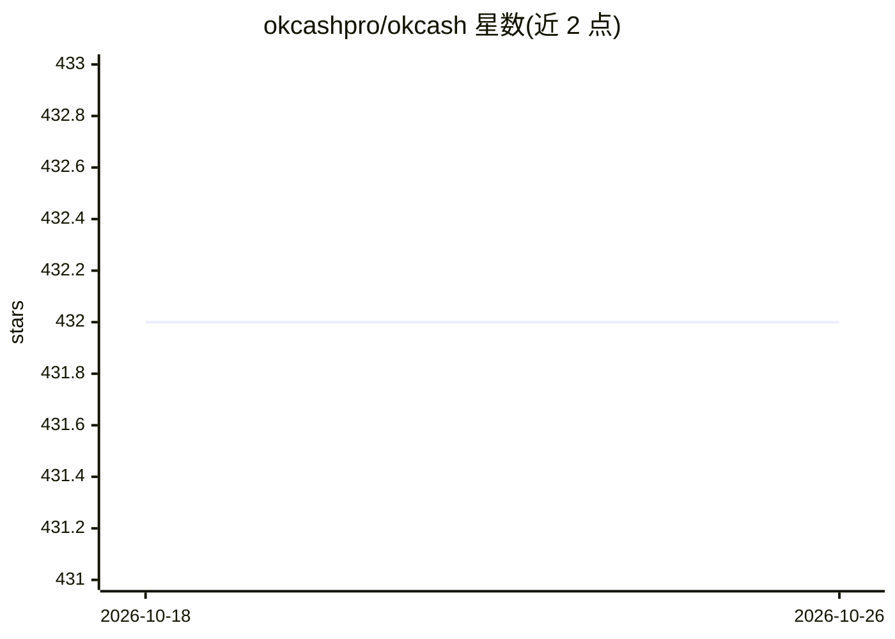

# okcashpro/okcash

⭐ 432 · C++ · MIT · 推送 2026-06-16 · [GitHub](https://github.com/okcashpro/okcash) · [官网](https://okcash.org) · 组织维护

**Okcash (OK) 加密货币多链合约仓库，展示各链代币地址**

Okcash 是 2014 年发起的开源混合共识加密货币（PoW-Scrypt 转 PoS-LTSS-Sha256，后转多链框架）。本仓库为其官方多链入口：列出了 OK 代币在 Base、Ethereum、Polygon、Avalanche、Arbitrum、Optimism、Fantom、Binance Smart Chain、Solana 上的智能合约地址，供在区块链浏览器查询、交易与接入 DeFi 生态使用。仓库同时汇集官网、白皮书、审计、社区渠道等资源，并预告 OK Multi Bridge 与 OK DAO。README 未给出可执行的安装或运行指引；描述中提及 AI agents，但正文未包含 AI 相关功能说明。

## 筛选速览

| 维度 | 判定 | 备注 |
|---|---|---|
| AI 角色 | `ai-enhanced` | 去掉 AI 部分产品仍成立 |
| 许可风险 | `permissive` | MIT |
| 部署形态 | `None` |  |
| 模型依赖 | — | README 未给出锁定关系 |
| 硬件要求 | — | 无带数字的原话,不猜 |
| 安装摩擦 | `low` | 无编译、无系统依赖或容器化 |
| 成熟度 | — | 结构信号不足 |

## 能力要点

- 列出 OK 代币在 9 条区块链上的智能合约地址
- 2014 年发起，经历 PoW→PoS→多链的演进
- 提供白皮书、Cyberscope 审计与社区渠道链接

## 适用场景

- 在各链浏览器查询或验证 OK 代币合约
- 将 OK 代币接入 DeFi 协议或交易
- 了解 Okcash 项目资源与社区入口

## 场景标签

`精选清单` · 领域:学习与行业

## 证据(README 行号)

> L8: OK represents the cutting edge of cryptocurrency innovation since its inception on November 24, 2014. Embodying the 
> L10: Welcome to the official repository for OK, showcasing Okcash's expansion into the multi-chain universe. Here, you'l

## 星数曲线

2026-10-18 432 → 2026-10-26 432（+0）

---
*卡片 v1 · prompt 1.4 · 生成 2026-10-21 · 置信度 low · 依据 README sha `ae5aa1922d24` · [字段定义](../../DATASET.md)*
