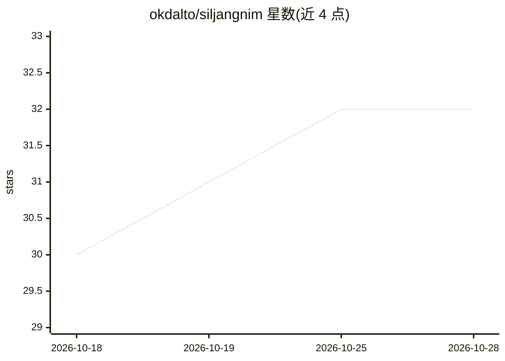

# okdalto/siljangnim

⭐ 32 · TypeScript · GPL-3.0 · 推送 2026-10-22 · [GitHub](https://github.com/okdalto/siljangnim) · [官网](https://siljangnim.vercel.app) · 个人维护 · 中文 README

**由 AI agent 驱动的创意编程工作室：对话生成实时视觉**

面向创作者的桌面/Web 创意编程工作室：用户用自然语言描述视觉效果，内置 agent 或外接 Claude Code/Codex/Cursor 等 MCP 客户端编写 WebGL2/WebGPU 场景代码，可对话修改、混合多个作品，通过滑块/旋钮/2D pad 等控件交互，支持鼠标、键盘、麦克风、MIDI、OSC（TouchOSC/Ableton/TouchDesigner）现场表演，并导出 MP4/WebM/PNG 帧。agent 可在本机安装并运行开源工具（Python 包、ffmpeg、Blender、ML 模型），成功的安装保存为 recipe 复用。内置 agent 默认运行于 Anthropic Claude，也可接任意 OpenAI 兼容服务器（OpenAI、vLLM、Ollama）。提供 macOS/Windows 安装包、MCP npm 包与浏览器版本；浏览器版无法运行本机工具，功能受限。安装包未代码签名，首次启动需手动放行。

## 筛选速览

| 维度 | 判定 | 备注 |
|---|---|---|
| AI 角色 | `ai-native` | 本体是模型或模型工具 |
| 许可风险 | `viral` | GPL-3.0 |
| 部署形态 | `desktop` | 安装包/桌面程序 |
| 模型依赖 | local-ok | 支持本地模型 |
| 硬件要求 | — | 无带数字的原话,不猜 |
| 安装摩擦 | `medium` | 含编译或系统依赖之一 |
| 成熟度 | — | 结构信号不足 |

## 能力要点

- 自然语言描述生成 WebGL2/WebGPU 场景，对话中持续修改并支持版本回溯
- MIDI/OSC/麦克风/摄像头实时控制，Perform 全屏输出与 Timeline 关键帧
- agent 可在本机安装运行 Python 包、ffmpeg、Blender 等开源工具并保存 recipe 复用
- 397 个基于开源项目（Three.js、p5.js、OpenCV 等）的示例，支持 MP4/WebM/4K 离线导出

## 适用场景

- 用对话描述并迭代生成实时视觉场景用于演出或短片
- 现场 VJ 表演：MIDI 控制器/OSC/音频驱动画面并全屏投影
- 把多个视觉作品混合、加控件调参并导出视频

## 场景标签

`编码 Agent` · 领域:编码与开发

## 证据(README 行号)

> L5:  A creative coding studio run by an agent.
> L23: > models, OSC — and the web can't do any of that. In the app, the chat runs on your own Claude Code or Codex, so it
> L165:  agent, which runs on Anthropic (Claude Opus 5.5 by default) or any OpenAI-compatible server (OpenAI, vLLM, Ollama

## 星数曲线

2026-10-18 30 → 2026-10-28 32（+2）

---
*卡片 v1 · prompt 1.4 · 生成 2026-10-26 · 置信度 high · 依据 README sha `032eb37983c8` · [字段定义](../../DATASET.md)*
