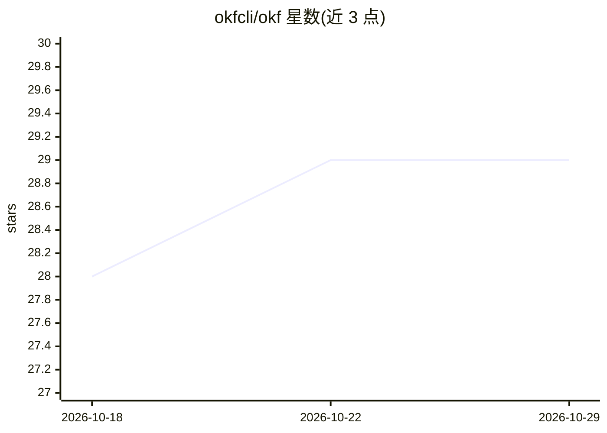

# okfcli/okf

⭐ 29 · Go · Apache-2.0 · 推送 2026-10-22 · [GitHub](https://github.com/okfcli/okf) · [官网](https://useokf.com) · 组织维护

**OKF 知识目录格式的厂商中立 Go CLI：创建/校验/索引/搜索**

面向 Open Knowledge Format（OKF，以带 YAML frontmatter 的 markdown 表示数据目录知识的开放格式）的命令行工具，单个静态二进制、无运行时依赖。命令覆盖 init、validate、lint、index、list、show、search、backlinks、graph 等，实现 OKF v0.2 的溯源、信任分级、生命周期与经证明计算契约校验。设计为 agent-first：okf schema 输出机器可读的 CLI 元数据、命令默认输出 JSON、错误采用结构化信封并带稳定退出码与规则 ID，支持 SARIF 供 CI 集成。项目处于早期开发阶段，serve/render/Go 库为规划功能。

## 筛选速览

| 维度 | 判定 | 备注 |
|---|---|---|
| AI 角色 | `ai-ecosystem` | LLM/agent 周边工具 |
| 许可风险 | `permissive` | Apache-2.0 |
| 部署形态 | `None` |  |
| 模型依赖 | — | README 未给出锁定关系 |
| 硬件要求 | — | 无带数字的原话,不猜 |
| 安装摩擦 | `low` | 无编译、无系统依赖或容器化 |
| 成熟度 | `idea` | |

## 能力要点

- 单个静态二进制，无运行时依赖，可校验百万级概念
- agent-first：schema 元数据、默认 JSON 输出、结构化错误信封与稳定规则 ID
- 实现 OKF v0.2：溯源、信任分级、生命周期、经证明计算契约
- validate 可输出 SARIF 2.1.0 供 GitHub 代码扫描集成

## 适用场景

- 让 AI agent 自主创建、校验并修复 OKF 知识包
- 审计迁移或收购遗留的大型 OKF 知识包并生成健康报告
- 在 CI 中对 OKF 变更做质量门禁与代码扫描
- 新成员入职时用 agent 逐层浏览团队知识地图

## 场景标签

`知识图谱` `知识库管理` · 领域:知识与检索

## 证据(README 行号)

> L9: Google's reference OKF implementation is Python + Gemini + BigQuery - vendor-locked to Google's cloud. `okf` is the 
> L11: **Agentic-first** means an AI agent can discover, understand, and drive the entire CLI without reading documentatio

## 星数曲线

2026-10-18 28 → 2026-10-29 29（+1）

---
*卡片 v1 · prompt 1.4 · 生成 2026-10-26 · 置信度 high · 依据 README sha `b4d24904f8b9` · [字段定义](../../DATASET.md)*
