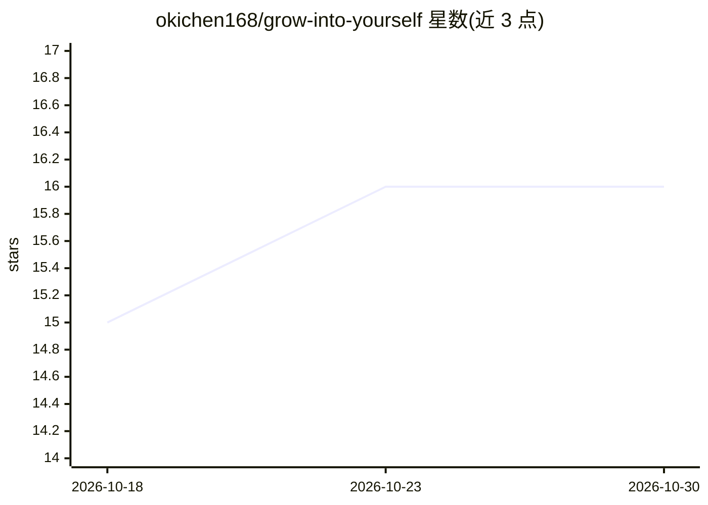

# okichen168/grow-into-yourself

⭐ 16 · TypeScript · MIT · 推送 2026-07-21 · [GitHub](https://github.com/okichen168/grow-into-yourself) · [官网](https://clear-translate.creamy-scarf-2160.chatgpt.site) · 个人维护 · 中文 README

**分析困难对话中心理操纵信号的隐私优先工具**

面向消费者的网页应用：用户粘贴对方消息与自己回复，服务端先产出本地、证据关联的逐句规则分析，标记内疚诱导、羞辱、责任转嫁、威胁、否认、孤立或控制等压力信号，并给出软/坚定/退出三种边界回复选项与风险分级。外部模型通过 OpenRouter 兼容配置作为可选增强层，缺失或超时本地结果仍保留。不做人格诊断，声称非治疗或应急服务，自述为早期公开测试。技术栈为 React/TypeScript/Vite，Cloudflare 运行时，双语（英/简中）。

## 筛选速览

| 维度 | 判定 | 备注 |
|---|---|---|
| AI 角色 | `ai-native` | 本体是模型或模型工具 |
| 许可风险 | `permissive` | MIT |
| 部署形态 | `library` | 以包/库形式分发 |
| 模型依赖 | locked-api |  |
| 硬件要求 | — | 无带数字的原话,不猜 |
| 安装摩擦 | `low` | 无编译、无系统依赖或容器化 |
| 成熟度 | `idea` | |

## 能力要点

- 本地优先的证据关联规则引擎，逐句标注压力信号
- 可选 OpenRouter 兼容外部 AI overlay，严格 schema 校验且失败不覆盖本地结果
- 输出软/坚定/退出三种边界回复选项与风险分级安全提示
- 38 条决策规则与 39 组最小对立对，强标签需更强证据；回归测试 71/71 通过

## 适用场景

- 复盘让我感到内疚或困惑的对话，看清其中的压力语言
- 获得不同语气的边界设定回复措辞参考
- 双语用户在亲密关系、家庭、职场等场景下逐句检视对话

## 场景标签

 · 领域:心理健康/人际关系工具

## 证据(README 行号)

> L34: |Separates the other person’s words from the user’s reply|Flags possible guilt, humiliation, blame-shifting, threat
> L65:                          ├─> /api/analyze ─> local evidence-linked analysis ─> structured JSON
> L85: |AI overlay|Configurable OpenRouter-compatible server request, strictly schema-validated|

## 星数曲线

2026-10-18 15 → 2026-10-30 16（+1）

---
*卡片 v1 · prompt 1.4 · 生成 2026-10-30 · 置信度 high · 依据 README sha `633062f4eaec` · [字段定义](../../DATASET.md)*
