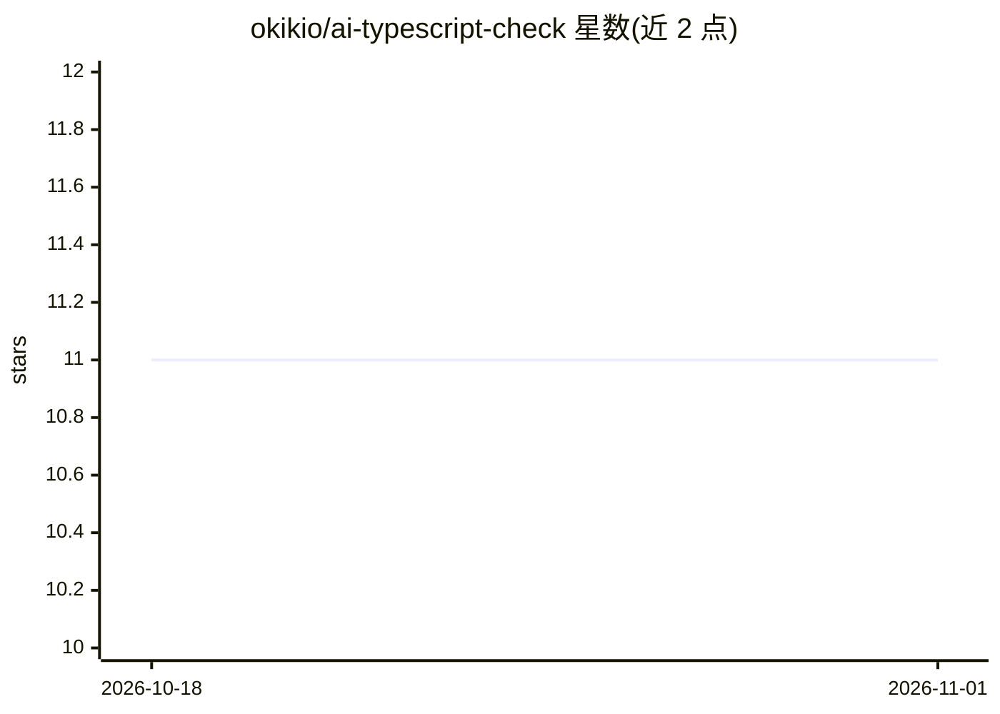

# okikio/ai-typescript-check

⭐ 11 · TypeScript · MIT · 推送 2026-07-24 · [GitHub](https://github.com/okikio/ai-typescript-check) · [官网](https://ts-check.okikio.dev) · 个人维护

**给 ChatGPT 等 AI 提供 TypeScript 检查的 REST API/插件**

基于修改版 @typescript/twoslash 的 REST API，对 TypeScript/JSX/TSX/JavaScript 代码提供 lint、错误检查、类型信息提取与补全分析，返回包含 errors、warnings、staticQuickInfos、queries 与 playgroundURL 的 JSON。主要形态是 ChatGPT 插件（可从 OpenAI 插件商店或手动输入 API URL 安装），也可作为独立 API 在任意编码环境中调用；提供 POST /twoslash（大段代码）与 GET /twoslash（≤254 字符）两个端点，支持自定义编译器选项与虚拟文件系统。MIT 许可。

## 筛选速览

| 维度 | 判定 | 备注 |
|---|---|---|
| AI 角色 | `ai-ecosystem` | LLM/agent 周边工具 |
| 许可风险 | `permissive` | MIT |
| 部署形态 | `None` |  |
| 模型依赖 | — | README 未给出锁定关系 |
| 硬件要求 | — | 无带数字的原话,不猜 |
| 安装摩擦 | `low` | 无编译、无系统依赖或容器化 |
| 成熟度 | — | 结构信号不足 |

## 能力要点

- 基于修改版 @typescript/twoslash 的类型/错误/lint 检查 API
- 两个端点：POST /twoslash 处理大段代码，GET /twoslash 处理 ≤254 字符
- 支持自定义 tsconfig 编译器选项与虚拟文件系统 fsMap
- 可作为 ChatGPT 插件或独立 API 使用

## 适用场景

- 给 ChatGPT 装 TypeScript 类型检查插件，让对话中核验代码
- 在编码环境/工具中以 REST API 调用 twoslash 类型分析
- 获取代码的错误、警告与各符号类型信息用于自动化处理

## 场景标签

 · 领域:开发者工具/代码分析 API

## 证据(README 行号)

> L5: `ai-typescript-check` is a ChatGPT plugin and API that provides linting, auto-completion, error checking, and type c
> L7: While primarily designed as a ChatGPT plugin for type checking TypeScript code, `ai-typescript-check` can also be us

## 星数曲线

2026-10-18 11 → 2026-11-01 11（+0）

---
*卡片 v1 · prompt 1.4 · 生成 2026-11-01 · 置信度 high · 依据 README sha `2c6dce081694` · [字段定义](../../DATASET.md)*
