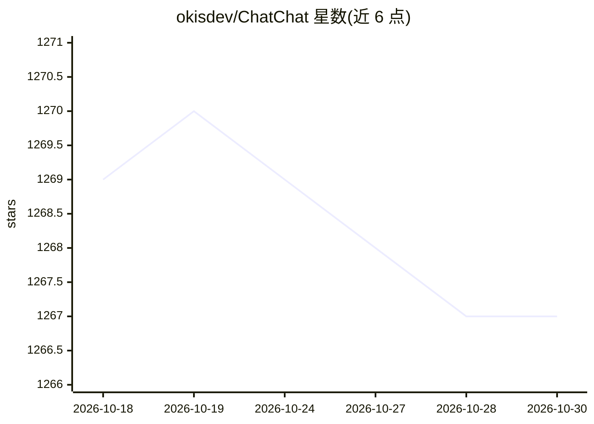

# okisdev/ChatChat

⭐ 1,267 · TypeScript · AGPL-3.0 · 推送 2026-10-28 · [GitHub](https://github.com/okisdev/ChatChat) · [官网](https://chat.okisdev.com) · 个人维护

**自托管的统一 AI 聊天与搜索平台**

基于 Next.js / Tailwind CSS / shadcn UI 构建的 Web 应用，提供聊天与搜索两类界面，支持接入 Anthropic、OpenAI、Cohere、Google Gemini 等 AI 提供商。面向希望自行部署统一 AI 入口的个人用户，支持在 Vercel、Railway 等平台部署，更多部署方式见其文档，采用 AGPL-3.0 许可。README 提示 AI 可能生成不当内容。

## 筛选速览

| 维度 | 判定 | 备注 |
|---|---|---|
| AI 角色 | `ai-native` | 本体是模型或模型工具 |
| 许可风险 | `viral` | AGPL-3.0 |
| 部署形态 | `None` |  |
| 模型依赖 | locked-api |  |
| 硬件要求 | — | 无带数字的原话,不猜 |
| 安装摩擦 | `low` | 无编译、无系统依赖或容器化 |
| 成熟度 | — | 结构信号不足 |

## 能力要点

- 统一的聊天与 AI 搜索 Web 界面
- 支持 Anthropic / OpenAI / Cohere / Google Gemini 等提供商
- 支持 Vercel、Railway 等多种部署方式，便于自托管

## 适用场景

- 自部署一个统一的 AI 对话与搜索入口
- 在同一界面中使用多家 AI 提供商的服务

## 场景标签

`聊天机器人` `模型网关` · 领域:Agent 开发

## 证据(README 行号)

> L3: > Your own unified chat and search to AI platform, with a simple and easy to use interface.
> L23: - Support major AI Providers (Anthropic, OpenAI, Cohere, Google Gemini, etc.)

## 星数曲线

2026-10-18 1,269 → 2026-10-30 1,267（-2）

---
*卡片 v1 · prompt 1.4 · 生成 2026-10-21 · 置信度 high · 依据 README sha `de83ea3f108a` · [字段定义](../../DATASET.md)*
