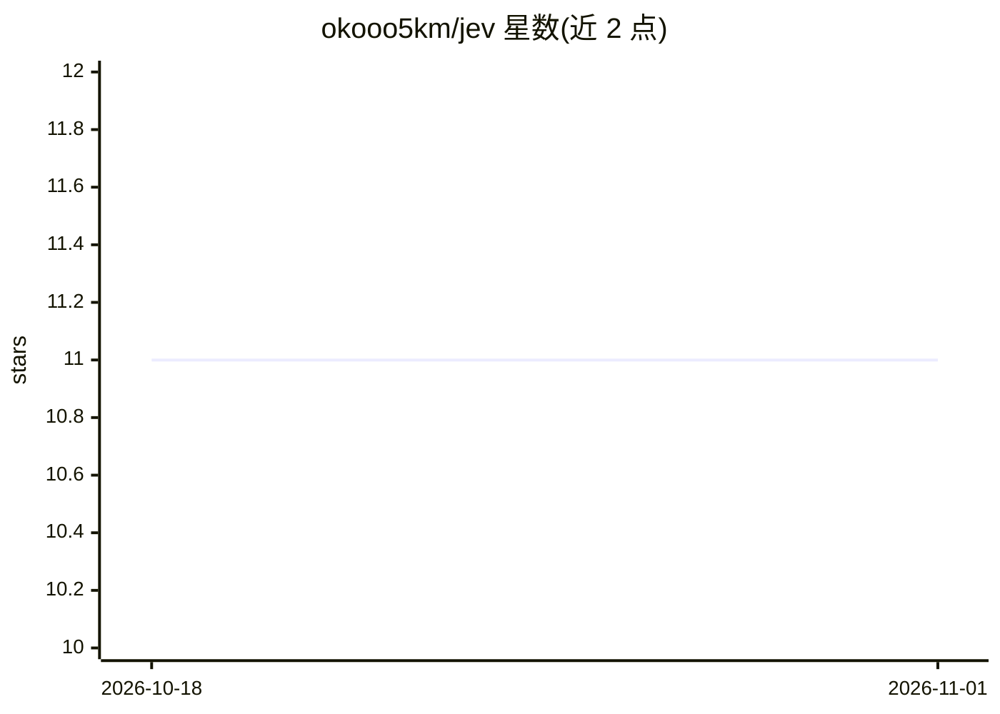

# okooo5km/jev

⭐ 11 · Python · Apache-2.0 · 推送 2026-09-19 · [GitHub](https://github.com/okooo5km/jev) · [官网](https://sink.5km.tech/skills) · 个人维护 · 中文 README

**从 shell 获取类型化判断的 CLI 与 Agent Skill：带校准概率的是非/选择/打分**

非官方社区封装，单文件、仅标准库、Python 3.9+，把 TypeSafe 的 Jev 决策模型封装成 CLI：`yes` 是非判断、`pick` 多选一、`score` 有序打分（最多 10 级，API 硬限制）、`filter` 语义 grep、`run` 批量多问（逐行模式 8 路并发、连接复用）。后端支持 TypeSafe 官方 API（默认）或 OpenRouter，密钥存于 ~/.config/jev/.env。Jev 只做决策不生成文本；Windows 未测试需 WSL。同时可作为 Agent Skill 安装到 Claude Code/Codex 等 agent。

## 筛选速览

| 维度 | 判定 | 备注 |
|---|---|---|
| AI 角色 | `ai-native` | 本体是模型或模型工具 |
| 许可风险 | `permissive` | Apache-2.0 |
| 部署形态 | `library` | 以包/库形式分发 |
| 模型依赖 | locked-api |  |
| 硬件要求 | — | 无带数字的原话,不猜 |
| 安装摩擦 | `low` | 无编译、无系统依赖或容器化 |
| 成熟度 | — | 结构信号不足 |

## 能力要点

- yes/pick/score/filter/run 五个动词，输出带校准概率与退出码
- 双后端：TypeSafe 官方 API（默认）与 OpenRouter，密钥 600 权限存储、支持 --stdin 非交互配置
- 内置 5 个 JSON spec 模板（mail/feedback/signal/commit/route），可自定义 JSON/TOML spec
- 逐行模式连接复用，40 行实测约 4 秒（-j 4）

## 适用场景

- 在 shell 或 CI 里对文本做批量分类、打分与过滤
- 让 Claude Code/Codex 等 agent 通过技能调用 Jev 做判断
- 把退款识别、反馈分诊、commit 分类等决策接进脚本流水线

## 场景标签

 · 领域:开发者工具/LLM 决策分类

## 证据(README 行号)

> L7: **命令行里的类型化判断：`yes`/`pick`/`score`，每个答案都带校准概率 —— 默认走 TypeSafe 官方 API，也支持 OpenRouter，CLI + Agent Skill。**
> L134: |`yes`|是非判断|`yes\t0.97`|0 yes · 1 no · 2 出错|

## 星数曲线

2026-10-18 11 → 2026-11-01 11（+0）

---
*卡片 v1 · prompt 1.4 · 生成 2026-11-01 · 置信度 mid · 依据 README sha `0562e45b6826` · [字段定义](../../DATASET.md)*
