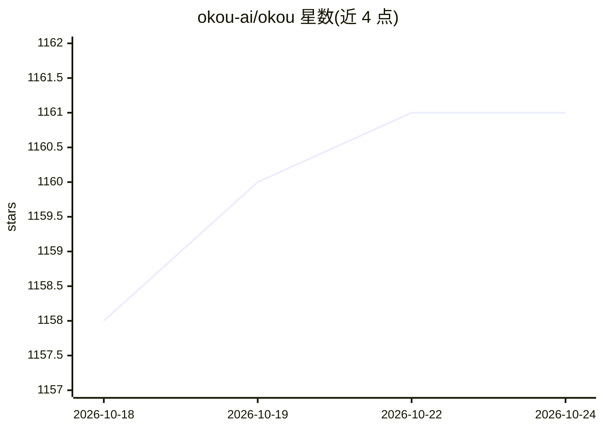

# okou-ai/okou

⭐ 1,161 · TypeScript · NOASSERTION · 推送 2026-10-24 · [GitHub](https://github.com/okou-ai/okou) · [官网](https://www.okou.ai) · 组织维护

**团队工作流 AI agent 平台：接入现有工具代为完成工作**

开源的 agentic 工作流运行时：以聊天方式 @ 提及 Okou 分派任务，agent 自行规划步骤、选择工具执行，覆盖营销、销售、工程、运营场景。工作流可保存为团队资产并按权限复用、定时或触发执行。安全机制包括草稿不代发、按工具按 agent 的细粒度读写权限、每任务在独立 Firecracker microVM 中隔离执行、全程日志可审计。支持 Slack、GitHub、Gmail、Notion 等 3,000+ 连接器；模型提供商可选 Anthropic、OpenAI、DeepSeek、Google 等。README 提供自托管与贡献指引链接，未给出具体安装命令。

## 筛选速览

| 维度 | 判定 | 备注 |
|---|---|---|
| AI 角色 | `ai-ecosystem` | LLM/agent 周边工具 |
| 许可风险 | `none` | NOASSERTION |
| 部署形态 | `None` |  |
| 模型依赖 | — | README 未给出锁定关系 |
| 硬件要求 | — | 无带数字的原话,不猜 |
| 安装摩擦 | `low` | 无编译、无系统依赖或容器化 |
| 成熟度 | — | 结构信号不足 |

## 能力要点

- 以对话分派任务，agent 自行规划步骤并选择工具执行
- 工作流保存为团队资产，支持按权限复用与定时/触发自动化
- 每任务在 Firecracker microVM 中隔离执行，凭据不出沙箱
- 3,000+ 工具连接器，模型提供商可按运行或按 agent 选择

## 适用场景

- 让团队用自然语言在 Slack/聊天中委派营销、销售、工程与运营任务
- 将重复工作固化为可复用、可定时运行的团队工作流
- 在草稿待审、权限隔离与可审计的约束下让 agent 操作企业工具

## 场景标签

`工作流自动化` `AI 助手` · 领域:效率与自动化

## 证据(README 行号)

> L15:  Okou connects to the tools your team already uses and does the work — across marketing, sales, engineering, and op
> L70: - **Isolated execution** — every task runs in its own Firecracker microVM. Credentials never leave the sandbox.
> L91: Model providers are yours to pick — Anthropic, OpenAI, DeepSeek, Google and others, selected per run or per agent.

## 星数曲线

2026-10-18 1,158 → 2026-10-24 1,161（+3）

---
*卡片 v1 · prompt 1.4 · 生成 2026-10-21 · 置信度 high · 依据 README sha `b72084c26f64` · [字段定义](../../DATASET.md)*
