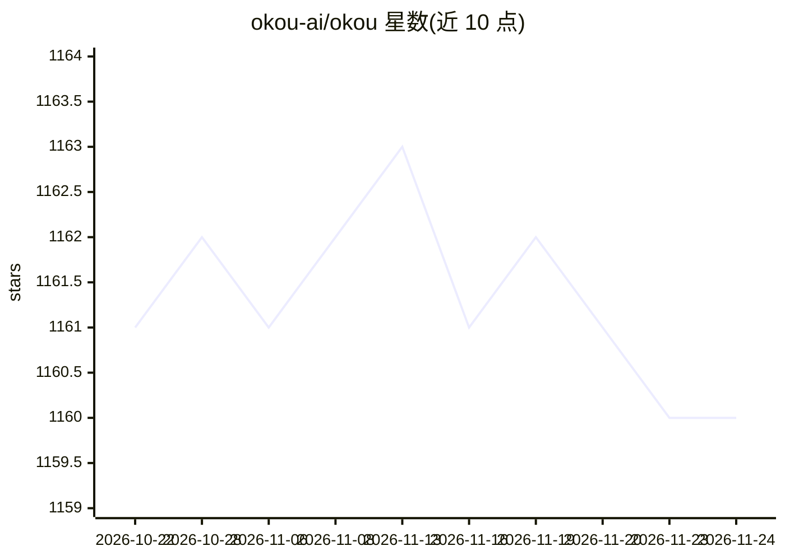

# okou-ai/okou

⭐ 1,161 · TypeScript · NOASSERTION · 推送 2026-11-24 · [GitHub](https://github.com/okou-ai/okou) · [官网](https://www.okou.ai) · 组织维护

**团队 AI 工作者：接入现有工具并代为执行跨部门任务**

Okou 是一个开源的团队 AI 代理产品：用户以 @mention 方式布置角色化任务，代理自行规划步骤并调用所需工具完成工作。关键机制包括：可复用工作流的运行-保存-交接-自动化四步沉淀、多任务并行聊天、每任务独立 Firecracker microVM 沙箱隔离、按工具/代理的细粒度权限，以及外发邮件和资金操作强制人工确认。支持 Slack 集成与自托管，模型提供方可按运行或按代理选择。

## 筛选速览

| 维度 | 判定 | 备注 |
|---|---|---|
| AI 角色 | `ai-native` | 本体是模型或模型工具 |
| 许可风险 | `none` | NOASSERTION |
| 部署形态 | `None` |  |
| 模型依赖 | — | README 未给出锁定关系 |
| 硬件要求 | — | 无带数字的原话,不猜 |
| 安装摩擦 | `low` | 无编译、无系统依赖或容器化 |
| 成熟度 | — | 结构信号不足 |

## 能力要点

- 任务级沙箱隔离：每个任务在独立 Firecracker microVM 中运行，凭证不出沙箱
- 外发动作人工把关：邮件草稿不自动发送，预算变动需审批
- 工作流资产化：重复任务可保存为团队共享工作流并定时/触发运行
- 30+ 预置任务配方，宣称 3,000+ 工具连接器

## 适用场景

- 让代理根据 CRM 数据起草投资人更新和营销外联内容
- 把 Sentry 噪音归类并转为工程工单
- 销售线索打分并起草跟进邮件
- 为新人生成入职清单和会议纪要

## 场景标签

`工作流自动化` `AI 助手` · 领域:效率与自动化

## 证据(README 行号)

> L14:  Give it a job, not a prompt.
> L70: - **Isolated execution** — every task runs in its own Firecracker microVM. Credentials never leave the sandbox.
> L91: Model providers are yours to pick — Anthropic, OpenAI, DeepSeek, Google and others, selected per run or per agent.

## 星数曲线

2026-10-22 1,161 → 2026-11-24 1,160（-1）

---
*卡片 v1 · prompt 1.4 · 生成 2026-11-24 · 置信度 mid · 依据 README sha `5ea6a45b6449` · [字段定义](../../DATASET.md)*
