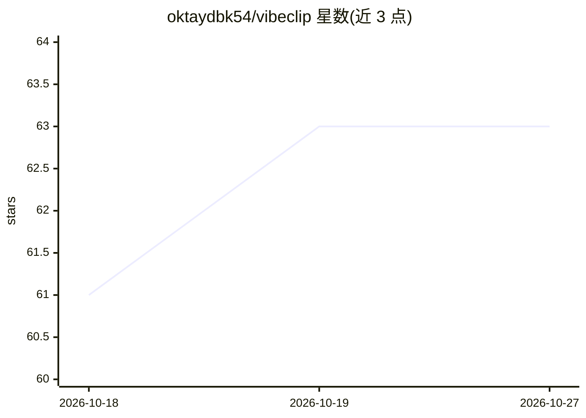

# oktaydbk54/vibeclip

⭐ 63 · Python · AGPL-3.0 · 推送 2026-06-25 · [GitHub](https://github.com/oktaydbk54/vibeclip) · [官网](https://vibeclip.dev) · 个人维护

**自托管 AI 视频编辑器：长视频切成竖屏短片，聊天改片**

面向内容创作者的自托管 Web 应用：上传播客、访谈等长视频后，本地 faster-whisper 转录、LLM 评分选出片段，自动重构成 9:16 竖屏并烧录逐字字幕；随后通过对话下达编辑指令（修剪、去语气词、缩放、配乐、品牌水印），由 tool-calling agent 执行且支持一步 undo。BYOK 模式接入 OpenAI/DeepSeek/Gemini/Claude 或任意 OpenAI 兼容端点；语音转文字与全部渲染本地运行（faster-whisper + ffmpeg），许可为 AGPL-3.0。提供 Docker Compose 一键部署与本地 uv/pip 安装两种方式，CLI 亦可直接处理视频。

## 筛选速览

| 维度 | 判定 | 备注 |
|---|---|---|
| AI 角色 | `ai-native` | 本体是模型或模型工具 |
| 许可风险 | `viral` | AGPL-3.0 |
| 部署形态 | `self-host` | docker 或自建部署 |
| 模型依赖 | local-ok | 支持本地模型 |
| 硬件要求 | — | 无带数字的原话,不猜 |
| 安装摩擦 | `low` | 无编译、无系统依赖或容器化 |
| 成熟度 | — | 结构信号不足 |

## 能力要点

- 本地 faster-whisper 转录 + LLM 评分选取片段，输出 9:16 逐字字幕短片
- 对话式 tool-calling agent 执行修剪/去语气词/缩放/配乐等编辑，一步 undo 回滚
- BYOK：支持 OpenAI/DeepSeek 原生接入及任意 OpenAI 兼容端点（Ollama、LM Studio、OpenRouter）
- 语音转文字与渲染均在本地运行，仅需 LLM key

## 适用场景

- 把播客或访谈长视频批量切成带字幕的竖屏短片
- 通过对话微调剪辑：改字幕大小、加缩放、换风格
- 不把素材和 prompt 交给第三方服务，自托管剪辑管线

## 场景标签

`图像视频处理` · 领域:感知与多模态

## 证据(README 行号)

> L9: **Drop in a long video — podcast, interview, talk, stream — and VibeClip cuts it into
> L40: |🎬 **Long → shorts, automatically**|Transcribes on-device, scores the strongest moments (hook / flow / value — not 
> L41: |💬 **Edit by chatting**|A tool-calling agent turns plain language into real edits — trims, filler-word removal (“uh

## 星数曲线

2026-10-18 61 → 2026-10-27 63（+2）

---
*卡片 v1 · prompt 1.4 · 生成 2026-10-24 · 置信度 mid · 依据 README sha `3f2672540a2a` · [字段定义](../../DATASET.md)*
