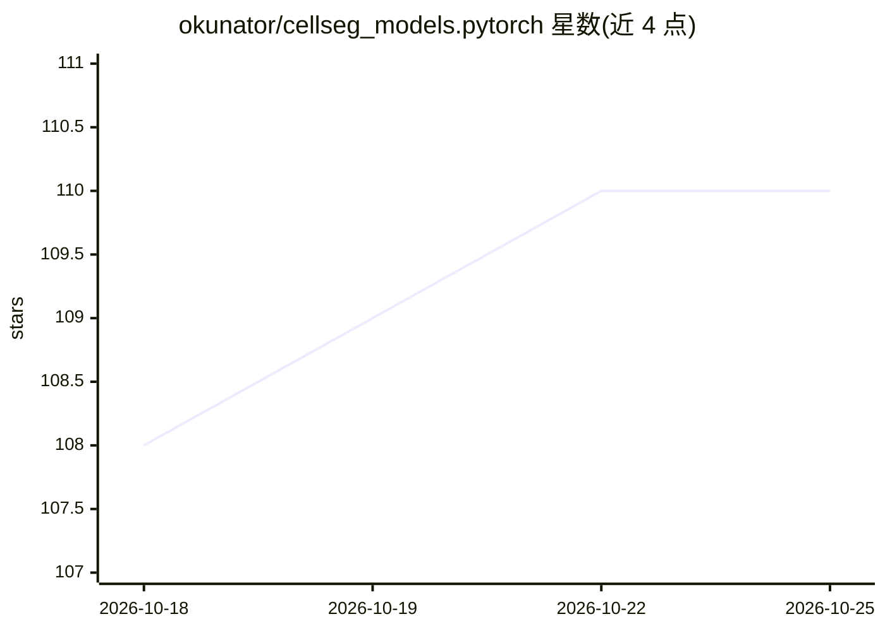

# okunator/cellseg_models.pytorch

⭐ 110 · Python · MIT · 推送 2026-10-22 · [GitHub](https://github.com/okunator/cellseg_models.pytorch) · [官网](https://okunator.github.io/cellseg_models.pytorch/) · 个人维护

**PyTorch 细胞/细胞核实例分割模型库，供显微图像分析**

基于 PyTorch 构建的 2D 细胞与细胞核实例分割 Python 库，提供六个多任务编码器-解码器模型家族（HoVer-Net、Cellpose、Omnipose、Stardist、CellVit-SAM、InstanSeg）及配套后处理方法；编码器、解码器与预测头可配置，支持细胞类型分类与可选组织分割，可对单张图像、滑动窗口与全切片图像做推理，并支持 ONNX 导出。通过 pip 安装，预训练权重托管于 CSMP Hub（Hugging Face），另提供数据集、变换、损失与指标用于训练评估。

## 筛选速览

| 维度 | 判定 | 备注 |
|---|---|---|
| AI 角色 | `ai-native` | 本体是模型或模型工具 |
| 许可风险 | `permissive` | MIT |
| 部署形态 | `library` | 以包/库形式分发 |
| 模型依赖 | — | README 未给出锁定关系 |
| 硬件要求 | — | 无带数字的原话,不猜 |
| 安装摩擦 | `low` | 无编译、无系统依赖或容器化 |
| 成熟度 | — | 结构信号不足 |

## 能力要点

- 六个细胞/细胞核实例分割模型家族（HoVer-Net、Cellpose、Omnipose、Stardist、CellVit-SAM、InstanSeg）
- 预训练权重通过 CSMP Hub（Hugging Face）分发
- 支持单图、滑动窗口与全切片图像推理及 ONNX 导出
- 提供 9 个带许可说明的制备数据集及训练/评估组件

## 适用场景

- 在显微图像或数字病理切片上分割细胞与细胞核实例
- 用 PanNuke 等公开数据集训练或微调分割模型
- 将分割模型导出为 ONNX 部署

## 场景标签

`目标检测` `微调` · 领域:感知与多模态

## 证据(README 行号)

> L18: **cellseg-models.pytorch** is a library built upon PyTorch that contains multi-task encoder-decoder architectures a
> L26: - Six model families for cell and nuclei instance segmentation.

## 星数曲线

2026-10-18 108 → 2026-10-25 110（+2）

---
*卡片 v1 · prompt 1.4 · 生成 2026-10-23 · 置信度 high · 依据 README sha `cb1bd8406596` · [字段定义](../../DATASET.md)*
