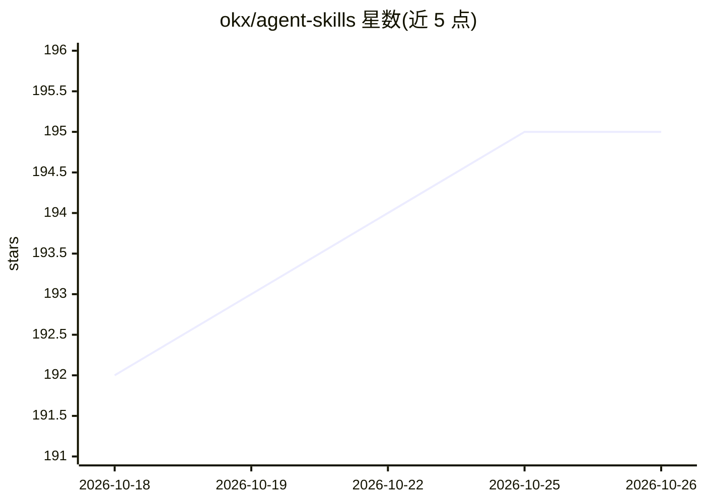

# okx/agent-skills

⭐ 195 · Shell · MIT · 推送 2026-10-19 · [GitHub](https://github.com/okx/agent-skills) · 组织维护 · 中文 README

**面向 LLM agent 的 OKX 交易所操作技能集**

OKX 官方维护的 AI agent 技能集合：每个技能是带 YAML frontmatter 的 Markdown 文件，由 AI 编程 agent 在激活时读取，经 `okx` CLI 执行交易所操作。技能覆盖 OAuth/API-key 认证、公开行情（70+ 技术指标）、现货与合约下单、账户与持仓管理、网格/DCA 机器人、理财、聪明钱分析与情绪追踪。依赖 npm 全局安装 @okx_ai/okx-trade-cli；description 字段受 Codex CLI 1024 字符限制。

## 筛选速览

| 维度 | 判定 | 备注 |
|---|---|---|
| AI 角色 | `ai-ecosystem` | LLM/agent 周边工具 |
| 许可风险 | `permissive` | MIT |
| 部署形态 | `library` | 以包/库形式分发 |
| 模型依赖 | — | README 未给出锁定关系 |
| 硬件要求 | — | 无带数字的原话,不猜 |
| 安装摩擦 | `low` | 无编译、无系统依赖或容器化 |
| 成熟度 | — | 结构信号不足 |

## 能力要点

- 8 类技能经 okx CLI 执行认证、行情、下单、组合与机器人操作
- Markdown+YAML frontmatter 格式，description 驱动 agent 路由
- 行情技能提供 70+ 技术指标且无需认证
- 支持 Claude Code / Cursor / Windsurf / Codex CLI 等 agent 加载

## 适用场景

- 让 AI 编程 agent 代为执行 OKX 交易与下单
- 通过对话查询行情、持仓与账户信息
- 让 agent 创建和监控网格/DCA 机器人

## 场景标签

`金融量化` · 领域:学习与行业

## 证据(README 行号)

> L3: A collection of AI agent skills for OKX exchange operations. Each skill is a self-contained Markdown file with YAML 
> L51: Skills are loaded by AI coding agents — Claude Code, Cursor, Windsurf, Codex CLI, and any Skills-Plugin-compatible 

## 星数曲线

2026-10-18 192 → 2026-10-26 195（+3）

---
*卡片 v1 · prompt 1.4 · 生成 2026-10-22 · 置信度 high · 依据 README sha `fe4f8996a824` · [字段定义](../../DATASET.md)*
