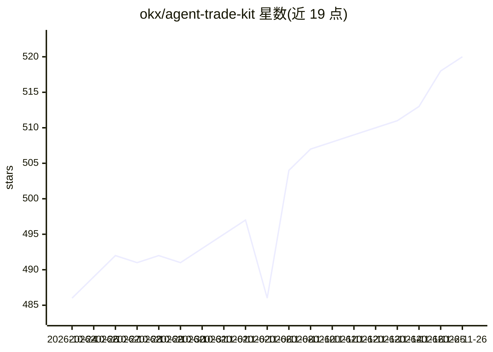

# okx/agent-trade-kit

⭐ 520 · TypeScript · MIT · 推送 2026-11-25 · [GitHub](https://github.com/okx/agent-trade-kit) · 组织维护 · 中文 README

**给 AI agent 接入 OKX 交易所的 MCP server 与 CLI 工具包**

包含两个独立包：okx-trade-mcp（面向 Claude、Cursor 等 MCP 兼容客户端的 MCP server）与 okx-trade-cli（终端操作 OKX 的 CLI）。以本地 stdio 进程运行，API key 仅存本机，无需服务器或数据库。提供 170 个工具，覆盖 11 个模块：行情数据（70+ 技术指标）、现货/永续/交割/期权下单、算法单（OCO、追踪止损）、账户管理、赚币、网格/DCA/智能组合交易机器人、事件合约、新闻与聪明钱信号。支持 --read-only、按模块过滤与内置限速等安全控制，并附带预构建的 agent skill 文件。

## 筛选速览

| 维度 | 判定 | 备注 |
|---|---|---|
| AI 角色 | `ai-enhanced` | 去掉 AI 部分产品仍成立 |
| 许可风险 | `permissive` | MIT |
| 部署形态 | `library` | 以包/库形式分发 |
| 模型依赖 | — | README 未给出锁定关系 |
| 硬件要求 | — | 无带数字的原话,不猜 |
| 安装摩擦 | `low` | 无编译、无系统依赖或容器化 |
| 成熟度 | — | 结构信号不足 |

## 能力要点

- 170 个工具覆盖 11 模块：行情、现货/合约/期权、算法单、账户、赚币、交易机器人
- 本地 stdio 进程运行，API key 不离开本机，无需服务器或数据库
- 安全控制：--read-only 只读模式、按模块过滤、内置限速器
- skills/ 目录附带 6 个预构建 agent skill 文件

## 适用场景

- 在 Claude Desktop 或 Cursor 中用自然语言直接下单和管理 OKX 账户
- 用 CLI 在终端查询行情、余额并执行现货/合约交易
- 为自建 AI agent 框架接入 OKX 交易技能文件
- 只读模式下查询市场数据与技术指标（无需鉴权）

## 场景标签

`金融量化` · 领域:学习与行业

## 证据(README 行号)

> L13: OKX Agent Trade Kit — an AI-powered trading toolkit with two standalone packages:
> L18: |`okx-trade-cli`|CLI for operating OKX from terminal|
> L33: |**Zero infrastructure**|Local stdio process, no server or database required|

## 星数曲线

2026-10-24 486 → 2026-11-26 520（+34）

---
*卡片 v1 · prompt 1.4 · 生成 2026-11-25 · 置信度 high · 依据 README sha `fa58efd4a33e` · [字段定义](../../DATASET.md)*
