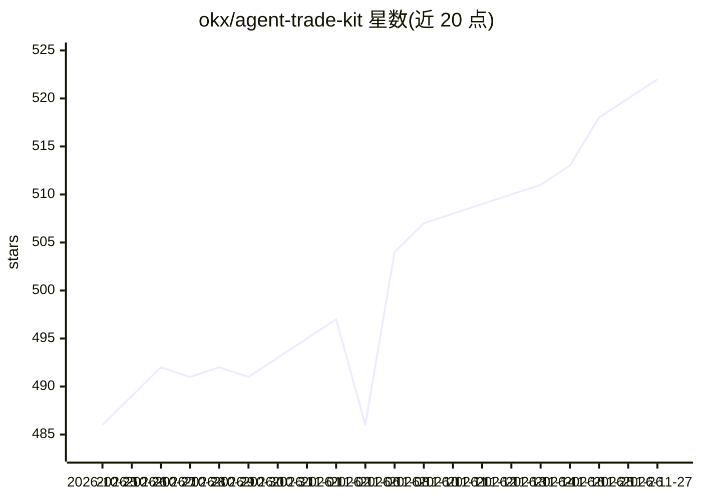

# okx/agent-trade-kit

⭐ 522 · TypeScript · MIT · 推送 2026-11-25 · [GitHub](https://github.com/okx/agent-trade-kit) · 组织维护 · 中文 README

**给 AI agent 连接 OKX 交易所的 MCP 服务器与 CLI**

由 OKX 开源的 TypeScript 工具包，含两个独立包：okx-trade-mcp 提供 174 个工具、11 个模块（行情、现货、合约、期权、账户、理财、交易机器人、事件合约、新闻、聪明钱信号），供 Claude Desktop、Cursor 等 MCP 客户端调用；okx-trade-cli 提供终端直接操作 OKX 的命令。本地 stdio 进程运行，API key 仅存本机，支持 --read-only、按模块过滤与内置限流；Node.js >= 18，支持 npm 安装与源码构建。

## 筛选速览

| 维度 | 判定 | 备注 |
|---|---|---|
| AI 角色 | `ai-ecosystem` | LLM/agent 周边工具 |
| 许可风险 | `permissive` | MIT |
| 部署形态 | `library` | 以包/库形式分发 |
| 模型依赖 | — | README 未给出锁定关系 |
| 硬件要求 | — | 无带数字的原话,不猜 |
| 安装摩擦 | `low` | 无编译、无系统依赖或容器化 |
| 成熟度 | — | 结构信号不足 |

## 能力要点

- 174 个工具覆盖交易全生命周期，分为 11 个模块（17 个子模块）
- MCP 标准协议，兼容 Claude Desktop、Cursor 等 MCP 客户端
- 本地 stdio 运行，API key 不离开本机，支持 --read-only 与按模块过滤
- 附 6 个预构建 Agent Skills 文件供 AI agent 框架使用

## 适用场景

- 让 AI 助手通过对话查询行情与执行 OKX 交易
- 在终端用 CLI 直接管理现货、合约与网格/DCA 机器人
- 跟踪聪明钱排行榜与共识信号做持仓分析

## 场景标签

`金融量化` · 领域:学习与行业

## 证据(README 行号)

> L17: |`okx-trade-mcp`|MCP server for Claude / Cursor and any MCP-compatible AI client|
> L22: OKX Agent Trade Kit connects AI assistants directly to your OKX account via the Model Context Protocol. Instead of 
> L34: |**MCP standard**|Works with Claude Desktop, Cursor, openCxxW, and any MCP-compatible client|

## 星数曲线

2026-10-25 486 → 2026-11-27 522（+36）

---
*卡片 v1 · prompt 1.4 · 生成 2026-11-26 · 置信度 high · 依据 README sha `4e5e7950e0a6` · [字段定义](../../DATASET.md)*
