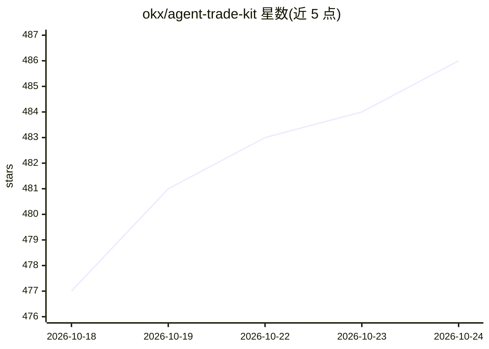

# okx/agent-trade-kit

⭐ 486 · TypeScript · MIT · 推送 2026-10-19 · [GitHub](https://github.com/okx/agent-trade-kit) · 组织维护 · 中文 README

**让 AI 代理经 MCP 直接交易 OKX 的工具包（MCP server + CLI）**

OKX 官方维护的交易工具包，含两个独立包：okx-trade-mcp（MCP server，供 Claude Desktop、Cursor 及任何 MCP 兼容客户端调用）与 okx-trade-cli（终端操作 OKX 的命令行工具）。共 170 个工具、11 个模块，覆盖行情（含 70+ 技术指标）、现货/永续/交割/期权下单、算法订单、账户、理财、网格与 DCA 机器人、事件合约、新闻与聪明钱分析。以本地 stdio 进程运行，API key 仅存本机；提供 --read-only、模块过滤与限流等安全控制，并附带 6 个 Agent Skills 技能文件。

## 筛选速览

| 维度 | 判定 | 备注 |
|---|---|---|
| AI 角色 | `ai-ecosystem` | LLM/agent 周边工具 |
| 许可风险 | `permissive` | MIT |
| 部署形态 | `library` | 以包/库形式分发 |
| 模型依赖 | — | README 未给出锁定关系 |
| 硬件要求 | — | 无带数字的原话,不猜 |
| 安装摩擦 | `low` | 无编译、无系统依赖或容器化 |
| 成熟度 | — | 结构信号不足 |

## 能力要点

- 170 个工具覆盖 11 个模块的完整交易生命周期
- 本地 stdio 进程运行，API key 不离开本机
- --read-only、按模块过滤与内置限流等安全控制
- 附带 6 个可即用的 Agent Skills 技能文件

## 适用场景

- 在 Claude/Cursor 等 AI 客户端中直接执行 OKX 交易与查询
- 通过终端 CLI 操作 OKX 现货、合约与交易机器人
- 让 AI 代理读取行情、技术指标与聪明钱信号做分析

## 场景标签

`金融量化` · 领域:学习与行业

## 证据(README 行号)

> L22: OKX Agent Trade Kit connects AI assistants directly to your OKX account via the Model Context Protocol. Instead of 
> L33: |**Zero infrastructure**|Local stdio process, no server or database required|

## 星数曲线

2026-10-18 477 → 2026-10-24 486（+9）

---
*卡片 v1 · prompt 1.4 · 生成 2026-10-21 · 置信度 high · 依据 README sha `4d9334db0d0a` · [字段定义](../../DATASET.md)*
