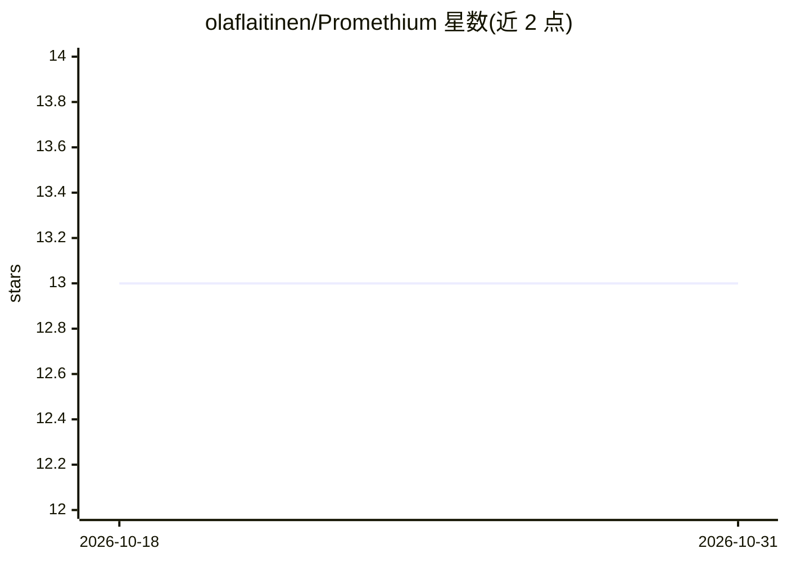

# olaflaitinen/Promethium

⭐ 13 · Python · MPL-2.0 · 推送 2026-09-11 · [GitHub](https://github.com/olaflaitinen/Promethium) · 个人维护

**地震数据重建、去噪与质量评分的 Python 库**

面向勘探地球物理、储层表征、地震学与微震监测等专业场景的地震数据处理库：在统一 API 下提供经典求解器与学习模型，覆盖缺失道重建、噪声压制、信号增强与数据规则化。AI/ML 部分包含 U-Net、VAE、GAN、PINN、Transformer 与神经算子等重建模型，并嵌入波动方程约束等物理信息组件。核心安装仅依赖 numpy 与 scipy，支持 SEG-Y、miniSEED、SAC 等多格式读写，另含 FastAPI 后端、Angular 前端与 Docker/Kubernetes 部署配置。

## 筛选速览

| 维度 | 判定 | 备注 |
|---|---|---|
| AI 角色 | `ai-native` | 本体是模型或模型工具 |
| 许可风险 | `permissive` | MPL-2.0 |
| 部署形态 | `self-host` | docker 或自建部署 |
| 模型依赖 | — | README 未给出锁定关系 |
| 硬件要求 | — | 无带数字的原话,不猜 |
| 安装摩擦 | `low` | 无编译、无系统依赖或容器化 |
| 成熟度 | — | 结构信号不足 |

## 能力要点

- 统一 API 下提供经典求解器与学习模型（U-Net/VAE/GAN/PINN/Transformer/神经算子）
- 核心安装仅依赖 numpy 与 scipy（Python 3.10-3.12）
- 多格式地震数据读写：SEG-Y、SEG-2、miniSEED、SAC、GCF
- 含 FastAPI 服务、Celery 任务队列与 Angular 可视化前端及容器化部署配置

## 适用场景

- 对缺失道地震数据做插值重建与去噪
- 将不规则采样数据规则化后交给下游处理流程
- 科研与勘探场景下做地震信号增强与质量评分

## 场景标签

`科研工具` · 领域:学习与行业

## 证据(README 行号)

> L6:  Reconstruction, denoising and quality scoring for seismic data,
> L64: ### State-of-the-Art AI/ML Reconstruction
> L131: |`src/promethium/ml/`|Machine learning model definitions, training loops, inference pipelines, and evaluation metr

## 星数曲线

2026-10-18 13 → 2026-10-31 13（+0）

---
*卡片 v1 · prompt 1.4 · 生成 2026-10-31 · 置信度 high · 依据 README sha `49ca747db033` · [字段定义](../../DATASET.md)*
