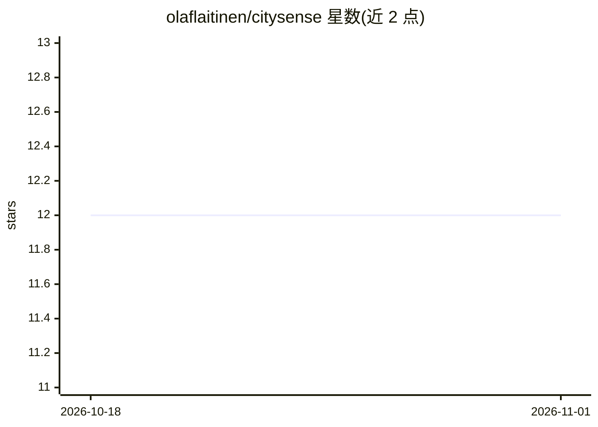

# olaflaitinen/citysense

⭐ 12 · Python · EUPL-1.2 · 推送 2026-08-01 · [GitHub](https://github.com/olaflaitinen/citysense) · [官网](https://pypi.org/project/citysense) · 个人维护

**面向城市分析的开源地理空间 RAG 与 MCP 工具库**

Python 库，将地理空间城市数据接入 LLM 工具链：提供自然语言意图解析、OSM→H3→嵌入→Qdrant 的索引路径、混合稠密/稀疏检索（RRF），并内置 FastMCP 服务器供 Cursor、Claude Desktop、VS Code 等客户端调用 query_spatial_context 工具。面向城市 AI 开发者、智慧城市研究者与政策工具构建者，对齐 SDG 11 与 WUF13。已实现 az/fi 两国试点配置；当前索引仅走 OSM 连接器路径，SSE 传输为占位实现，MCP 仅暴露一个工具。

## 筛选速览

| 维度 | 判定 | 备注 |
|---|---|---|
| AI 角色 | `ai-ecosystem` | LLM/agent 周边工具 |
| 许可风险 | `viral` | EUPL-1.2 |
| 部署形态 | `self-host` | docker 或自建部署 |
| 模型依赖 | — | README 未给出锁定关系 |
| 硬件要求 | — | 无带数字的原话,不猜 |
| 安装摩擦 | `low` | 无编译、无系统依赖或容器化 |
| 成熟度 | `idea` | |

## 能力要点

- 自然语言查询转为结构化地理空间结果（CLI 与 MCP 工具）
- OSM→H3→嵌入→Qdrant 索引路径与 RRF 混合检索
- Sentinel-2 光谱指数（NDVI/NDWI/NDBI 等）与 SDG 11 指标
- 内置 FastMCP 服务器，支持 Cursor / Claude Desktop 集成

## 适用场景

- 用自然语言查询城市空间上下文并获取 GeoJSON 结果
- 在 Cursor / Claude Desktop 中通过 MCP 调用空间查询工具
- 按 SDG 11 指标做城市分析与试点国家对比研究

## 场景标签

`RAG` · 领域:知识与检索

## 证据(README 行号)

> L97: CitySense is an open-source Python library for geospatial retrieval-augmented generation (RAG) and MCP-based AI too
> L103: |Primary function|Semantic geospatial retrieval and MCP server for urban AI|
> L139: |MCP integration|Native Model Context Protocol server for Cursor, Claude, VS Code|

## 星数曲线

2026-10-18 12 → 2026-11-01 12（+0）

---
*卡片 v1 · prompt 1.4 · 生成 2026-11-01 · 置信度 mid · 依据 README sha `ef7cb72b8908` · [字段定义](../../DATASET.md)*
