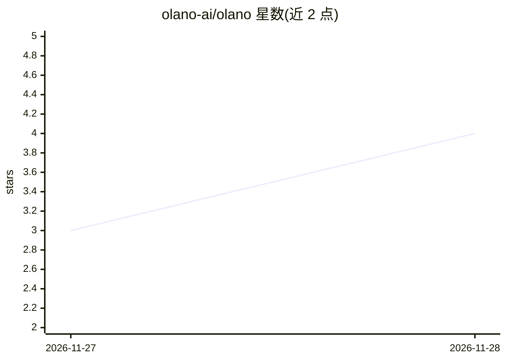

# olano-ai/olano

⭐ 4 · Python · MIT · 推送 2026-11-27 · [GitHub](https://github.com/olano-ai/olano) · [官网](https://docs.olano.ai/) · 组织维护 · 中文 README

**自托管 AI agent 团队运行时：记忆、工具、通道、调度与仪表盘**

以单个长驻进程运行多个 AI agent 的自托管运行时：每个 agent 由一份 `agent.json5` 声明配置，拥有磁盘工作区、工具与技能、跨会话记忆、调度计划和聊天通道；进程提供 web 仪表盘（Mission Control）、REST/SSE API 与 CLI。基于 LangChain 的 deepagents harness 与 LangGraph 构建，外围补充 88 个工具集成模块、21 个消息平台适配器、Docker 沙箱与安全管线、MCP/A2A 双向互通。推荐 Docker 安装（需 2 CPU、4 GB RAM），亦可从源码运行，线程状态写入 Postgres 或 SQLite。

## 筛选速览

| 维度 | 判定 | 备注 |
|---|---|---|
| AI 角色 | `ai-ecosystem` | LLM/agent 周边工具 |
| 许可风险 | `permissive` | MIT |
| 部署形态 | `desktop` | 安装包/桌面程序 |
| 模型依赖 | local-ok | 支持本地模型 |
| 硬件要求 | — | 无带数字的原话,不猜 |
| 安装摩擦 | `low` | 无编译、无系统依赖或容器化 |
| 成熟度 | — | 结构信号不足 |

## 能力要点

- 每个 agent 一份 JSON5 声明配置，含模型、工具、记忆、调度与安全设置
- 88 个工具模块（约 900 个工具）与 21 个消息平台适配器
- Docker 沙箱加出口防火墙，配 PII 扫描、提示注入检测与人审门控
- MCP 客户端/服务器与 A2A 客户端/服务器双向互通

## 适用场景

- 在自有服务器上托管一个团队式 AI agent 编队
- 通过 Telegram、Slack、飞书等聊天渠道与 agent 协作并审批任务
- 让 agent 按定时计划执行并自动沉淀记忆

## 场景标签

`Agent 框架` `多智能体` · 领域:Agent 开发

## 证据(README 行号)

> L11: Olano is a self-hosted runtime that runs a fleet of AI agents. Each agent has a
> L17: It is built on LangChain's Deep Agents
> L43: |**Interoperability**|MCP client (stdio and HTTP, OAuth, connection health loop); MCP server that exposes agents as

## 星数曲线

2026-11-27 3 → 2026-11-28 4（+1）

---
*卡片 v1 · prompt 1.4 · 生成 2026-11-27 · 置信度 mid · 依据 README sha `ad07cbf3a357` · [字段定义](../../DATASET.md)*
