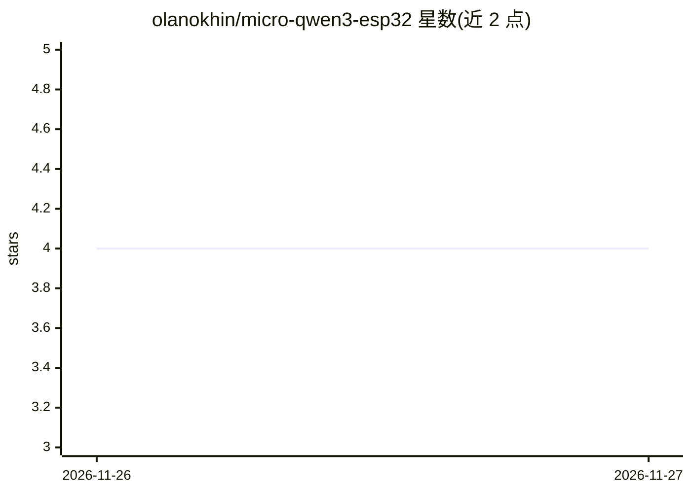

# olanokhin/micro-qwen3-esp32

⭐ 4 · Python · Apache-2.0 · 推送 2026-11-25 · [GitHub](https://github.com/olanokhin/micro-qwen3-esp32) · [官网](https://tensorlupa.com/flash) · 个人维护

**在 ESP32-S3 上离线运行 1M 参数 Qwen3 风格模型的固件与训练代码**

一个 1,056,656 参数、逐块遵循 Qwen3 架构的语言模型项目，在 TinyStories 上从零训练，以 4-bit 格式（0.68 MB 权重）在 ESP32-S3 上离线以约 72 tokens/s 生成短故事。仓库含 ESP-IDF 固件、无依赖的单文件 C 推理引擎（亦可在电脑上运行）、MLX 训练代码、导出脚本、训练日志，以及可在浏览器逐步观察推理的 TensorLupa。支持浏览器一键刷入、esptool 命令行刷入或 ESP-IDF 源码构建；无开发板时可经 Colab/T4 复现训练链。

## 筛选速览

| 维度 | 判定 | 备注 |
|---|---|---|
| AI 角色 | `ai-native` | 本体是模型或模型工具 |
| 许可风险 | `permissive` | Apache-2.0 |
| 部署形态 | `library` | 以包/库形式分发 |
| 模型依赖 | — | README 未给出锁定关系 |
| 硬件要求 | — | 无带数字的原话,不猜 |
| 安装摩擦 | `low` | 无编译、无系统依赖或容器化 |
| 成熟度 | — | 结构信号不足 |

## 能力要点

- 1.057M 参数 Qwen3 风格模型，4-bit 权重 0.68 MB，约 72 tokens/s 离线生成
- 无依赖单文件 C 推理引擎，可在板端（整数推理）与主机端运行并做一致性校验
- 浏览器刷入工具与终端 esptool 刷入两种途径，固件+模型打包为单一 bin
- 提供 MLX 训练配方、W4R 导出与可在免费 T4 上复现的 Colab 笔记本

## 适用场景

- 在无网络的微控制器上做端侧语言模型生成演示
- 按 README 训练配方在 Colab 上复现或调整模型后导出固件
- 教学/研究：在浏览器中逐步观察小型 Transformer 的推理过程

## 场景标签

`推理引擎` `模型量化` `模型训练` · 领域:训练与推理

## 证据(README 行号)

> L3: A language model with **1,056,656 parameters** that writes short stories on an ESP32-S3 microcontroller, offline, at
> L5: The model follows the Qwen3 architecture block by block and is trained from scratch on TinyStories. Its weights take
> L22: ## Flash a board

## 星数曲线

2026-11-26 4 → 2026-11-27 4（+0）

---
*卡片 v1 · prompt 1.4 · 生成 2026-11-26 · 置信度 high · 依据 README sha `ff0bd140fff7` · [字段定义](../../DATASET.md)*
