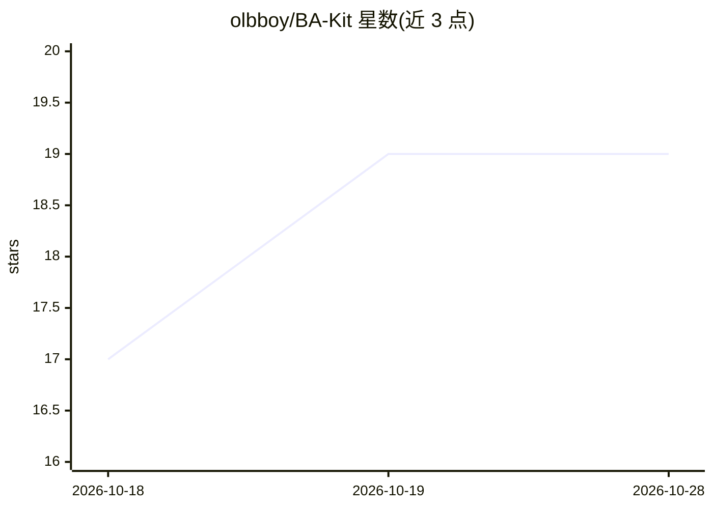

# olbboy/BA-Kit

⭐ 19 · Python · NOASSERTION · 推送 2026-04-13 · [GitHub](https://github.com/olbboy/BA-Kit) · 个人维护

**面向需求工程的 44 个 BA 专员 Agent 技能包**

运行于 Antigravity IDE、Claude Code、Claude CoWork 三个代理平台的业务分析 agent 编队：44 个各有角色与工具集的专员（引导、写作、验证、追溯、Jira/Confluence 桥接等），每个内置 System 2 反思循环与反合理化护栏，统一映射到 7 阶段循环。附 BM25+ 知识检索引擎（831 条目、23 域），通过复制技能目录或 setup.sh 安装，Python 脚本提供知识检索。许可为 CC BY-NC 4.0（非商业）。

## 筛选速览

| 维度 | 判定 | 备注 |
|---|---|---|
| AI 角色 | `ai-ecosystem` | LLM/agent 周边工具 |
| 许可风险 | `none` | NOASSERTION |
| 部署形态 | `None` |  |
| 模型依赖 | — | README 未给出锁定关系 |
| 硬件要求 | — | 无带数字的原话,不猜 |
| 安装摩擦 | `low` | 无编译、无系统依赖或容器化 |
| 成熟度 | — | 结构信号不足 |

## 能力要点

- 44 个专员 agent 覆盖需求工程 7 阶段（Discover→Reflect）
- 每个 agent 内置 System 2 反思循环与反合理化护栏
- BM25+ 知识检索引擎，831 条目、23 个领域
- Jira/Confluence 集成桥接与 Mermaid v11 图表生成

## 适用场景

- 在 Claude Code 或 Antigravity 中召唤专员生成需求规格、ROI 分析
- 对照交付证据检测规格与实现之间的漂移
- 跨 BRD/SRS/RTM 做一致性审计与质量门禁
- 把用户故事转换为 Jira 工单并发布到 Confluence

## 场景标签

`Agent 框架` `提示工程` · 领域:Agent 开发

## 证据(README 行号)

> L23: BA-Kit is **not a prompt library**. It is an **agent squad** for agentic AI platforms.
> L25: It replaces the single-chatbot approach with **44 specialists** — each with a defined role, toolset, System 2 Refle
> L137: **Antigravity IDE**

## 星数曲线

2026-10-18 17 → 2026-10-28 19（+2）

---
*卡片 v1 · prompt 1.4 · 生成 2026-10-28 · 置信度 high · 依据 README sha `6b9de1269f1f` · [字段定义](../../DATASET.md)*
