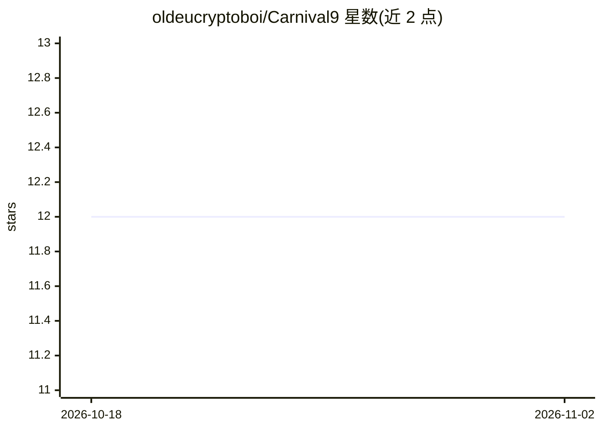

# oldeucryptoboi/Carnival9

⭐ 12 · TypeScript · MIT · 推送 2026-03-21 · [GitHub](https://github.com/oldeucryptoboi/Carnival9) · [官网](https://github.com/oldeucryptoboi/KarnEvil9) · 个人维护

**确定性 AI agent 运行时：结构化计划、类型化工具与可回放执行**

TypeScript 实现的开源 agent 运行时，将自然语言任务转为显式结构化执行计划，逐步通过输入校验、权限门控、类型化工具执行与结果记录。实现 Google DeepMind 智能委派框架的九项安全机制（认知摩擦、责任熔断、托管保证金、共识验证等），事件以 SHA-256 哈希链日志记录并可带完整性校验回放。pnpm monorepo 含 15 个包，提供 CLI、REST/WebSocket API、插件系统、调度器与 Prometheus 指标；限制：需 Node.js>=20 与 pnpm>=9.15 从源码构建。

## 筛选速览

| 维度 | 判定 | 备注 |
|---|---|---|
| AI 角色 | `ai-ecosystem` | LLM/agent 周边工具 |
| 许可风险 | `permissive` | MIT |
| 部署形态 | `self-host` | docker 或自建部署 |
| 模型依赖 | locked-api |  |
| 硬件要求 | — | 无带数字的原话,不猜 |
| 安装摩擦 | `low` | 无编译、无系统依赖或容器化 |
| 成熟度 | — | 结构信号不足 |

## 能力要点

- 计划为显式数据结构，每次运行可回放与审计，SHA-256 哈希链防篡改日志
- 实现 DeepMind 委派框架九项安全机制（托管保证金、声誉追踪、自动重委派等）
- 六种权限决策类型与策略执行（路径白名单、SSRF 防护、命令过滤）
- 插件系统含 Claude Code、OpenAI Codex、Slack/Signal/WhatsApp/Gmail 等集成

## 适用场景

- 以可审计、带权限门控的方式运行多步 agent 任务
- 按 DeepMind 委派框架搭建带安全治理的多 agent 委派
- 通过 REST/WebSocket API 将受控 agent 执行接入自有系统

## 场景标签

`Agent 框架` `多智能体` · 领域:Agent 开发

## 证据(README 行号)

> L5: KarnEvil9 is an open-source deterministic agent runtime that converts natural-language tasks into structured executi
> L35: |`karnevil9 run <task>`|Execute a task end-to-end|
> L89: KarnEvil9 is a pnpm monorepo with 15 packages under `packages/`, all scoped as `@karnevil9/*`:

## 星数曲线

2026-10-18 12 → 2026-11-02 12（+0）

---
*卡片 v1 · prompt 1.4 · 生成 2026-11-01 · 置信度 mid · 依据 README sha `d0ee7314b0b8` · [字段定义](../../DATASET.md)*
