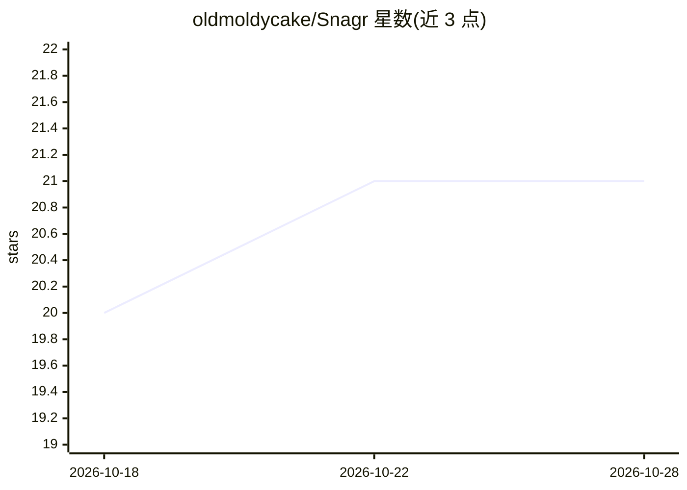

# oldmoldycake/Snagr

⭐ 21 · Python · AGPL-3.0 · 推送 2026-10-25 · [GitHub](https://github.com/oldmoldycake/Snagr) · 个人维护

**自托管二手市场价格追踪器：LLM agent 驱动浏览器巡检在售商品**

面向自托管/家庭实验室用户的价格监控应用：用户设定目标物品与价格，常驻的 LangChain agent 通过 Playwright MCP 操作真实无头浏览器在各二手市场站搜索新商品并复检已追踪商品，React 仪表盘实时展示最佳价、价格历史与 agent 活动。后端为 FastAPI，数据库是 agent 与后端的唯一接口。模型可插拔，适配 OpenRouter/OpenAI/Anthropic/Ollama 等多家 provider。多数复检通过定位符回放而不调用模型；触发反爬的站点会熔避。可选 DINOv3 视觉真伪鉴别。需 PostgreSQL+pgvector，处于 0.x 早期阶段。

## 筛选速览

| 维度 | 判定 | 备注 |
|---|---|---|
| AI 角色 | `ai-native` | 本体是模型或模型工具 |
| 许可风险 | `viral` | AGPL-3.0 |
| 部署形态 | `self-host` | docker 或自建部署 |
| 模型依赖 | local-ok | 支持本地模型 |
| 硬件要求 | — | 无带数字的原话,不猜 |
| 安装摩擦 | `low` | 无编译、无系统依赖或容器化 |
| 成熟度 | `idea` | |

## 能力要点

- 常驻 agent 队列驱动 Playwright MCP 无头浏览器搜索与复检商品
- 多数复检不调用模型：定位符回放，可退化为纯 HTTP GET
- 价格历史全记录、异常读数二次确认、拍卖出价不计入价格
- MCP 接口允许 Claude Code 等 MCP 客户端以受限 token 操作

## 适用场景

- 蹲守二手市场特定商品的低价在售
- 跨多个市场站统一追踪同一物品的价格走势
- 目标价命中时通过 ntfy/Discord/webhook 收到通知

## 场景标签

`浏览器自动化` `网页抓取` · 领域:效率与自动化

## 证据(README 行号)

> L8: A self-hosted price tracker for secondhand-marketplace hunting. You describe what you're watching for and at what pr
> L25: - **LLM scraping through a real browser** — the agent works marketplace pages via Playwright MCP, so it sees what y
> L26: - **An agent that is always on** — the agent is a daemon working a queue, not a batch job you start. A new watch is

## 星数曲线

2026-10-18 20 → 2026-10-28 21（+1）

---
*卡片 v1 · prompt 1.4 · 生成 2026-10-28 · 置信度 mid · 依据 README sha `2f384d0e137a` · [字段定义](../../DATASET.md)*
