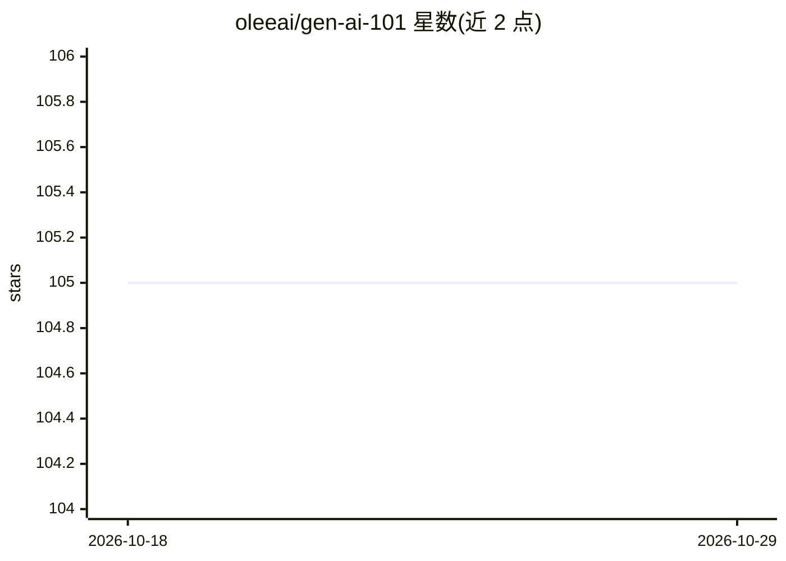

# oleeai/gen-ai-101

⭐ 105 · JavaScript · 推送 2026-07-14 · [GitHub](https://github.com/oleeai/gen-ai-101) · [官网](https://www.olee.ai) · 组织维护

**Node.js 生成式 AI 入门教学示例集与认证测评**

面向开发者、学生与教学者的 Gen AI 入门 starter kit：基于 GitHub Models 推理 API（GPT-4o、GPT-5、o1-preview）以 Node.js 展示基础对话、多轮会话、流式输出、图像输入、函数调用、推理模型、互动创意写作与自动化代码审查共 9 类示例脚本，每类附运行命令。另含测评任务：在 assessment.js 实现多轮编程助手聊天机器人并提交 PR，经审核后可获 Oleeai 颁发的证书与徽章。使用需 GitHub 个人访问令牌（models:read 权限）。

## 筛选速览

| 维度 | 判定 | 备注 |
|---|---|---|
| AI 角色 | `ai-knowledge` | 知识聚合/清单类 |
| 许可风险 | `none` | — |
| 部署形态 | `library` | 以包/库形式分发 |
| 模型依赖 | — | README 未给出锁定关系 |
| 硬件要求 | — | 无带数字的原话,不猜 |
| 安装摩擦 | `low` | 无编译、无系统依赖或容器化 |
| 成熟度 | — | 结构信号不足 |

## 能力要点

- 9 类可运行示例：对话/多轮/流式/图像/工具调用/推理/创意写作/代码审查
- 通过 GitHub Models 推理 API 接入 GPT-4o、GPT-5、o1-preview
- 测评任务：实现多轮编程助手聊天机器人，提交 PR 换取证书与徽章
- 附 GitHub token 申请步骤与视频指南

## 适用场景

- 按步骤学习如何在 Node.js 中调用 GitHub Models 的 GPT 模型
- 完成测评任务获得结业证书与徽章
- 复用示例代码快速搭建聊天或图像处理原型

## 场景标签

`教程课程` · 领域:学习与行业

## 证据(README 行号)

> L3: This repository provides a comprehensive starter kit for leveraging GitHub's GPT-4o and GPT-5 AI models with Node.js
> L162: **Complete the assessment as described below to earn your certificate and badge!**

## 星数曲线

2026-10-18 105 → 2026-10-29 105（+0）

---
*卡片 v1 · prompt 1.4 · 生成 2026-10-23 · 置信度 high · 依据 README sha `969583af6531` · [字段定义](../../DATASET.md)*
