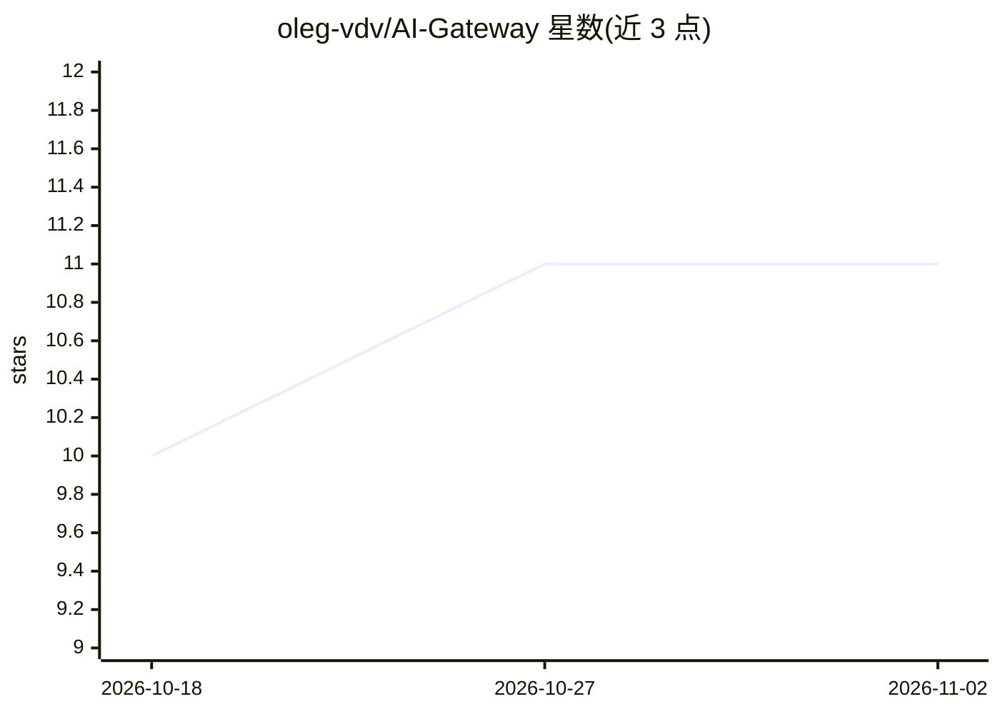

# oleg-vdv/AI-Gateway

⭐ 11 · Python · AGPL-3.0 · 推送 2026-10-25 · [GitHub](https://github.com/oleg-vdv/AI-Gateway) · 个人维护

**私有部署的 LLM 合规网关：出网前可逆脱敏 PII 与密钥**

AI-Gate 是部署在用户与外部 LLM（ChatGPT/Claude/Gemini 及任意 OpenAI 兼容 API）之间的本地网关：检测提示中的国民身份号、姓名、银行账号、API 密钥等敏感数据，以可逆令牌化方式掩码后再发出，并在响应中还原真实值；每条决策写入 SHA-256 哈希链的防篡改审计日志。面向需要在企业内使用 LLM 同时满足数据合规的团队，提供出口代理、浏览器扩展、剪贴板端点代理三种接入通道，支持本地模型路由使敏感数据不出网。核心为零依赖纯 Python 标准库实现，默认 fail-closed；检测规则带哈萨克/俄罗斯区域特性。

## 筛选速览

| 维度 | 判定 | 备注 |
|---|---|---|
| AI 角色 | `ai-ecosystem` | LLM/agent 周边工具 |
| 许可风险 | `dual` | AGPL-3.0 |
| 部署形态 | `self-host` | docker 或自建部署 |
| 模型依赖 | local-ok | 支持本地模型 |
| 硬件要求 | — | 无带数字的原话,不猜 |
| 安装摩擦 | `low` | 无编译、无系统依赖或容器化 |
| 成熟度 | — | 结构信号不足 |

## 能力要点

- 可逆令牌化而非删除：IIN 等敏感值出网为占位符、响应中还原
- 校验和验证检测（IIN 加权算法、IBAN mod-97、Luhn）+ 熵匹配密钥格式
- SHA-256 哈希链的防篡改审计日志，仅记录类型与计数不存明文值
- 零依赖纯 Python 核心可在空气隔离环境运行；fail-closed 默认拦截

## 适用场景

- 员工使用 ChatGPT/Claude/Gemini 前自动脱敏个人数据
- 内部应用与 RAG 流程通过替换 base_url 接入网关做 DLP
- 含敏感数据的请求按策略强制路由到本地模型，数据不出网

## 场景标签

`模型网关` `网络安全` · 领域:Agent 开发

## 证据(README 行号)

> L12: **Let people use LLMs without leaking data.** AI-Gate sits between your users
> L73: - **Multi-provider, including local models.** A provider registry covers

## 星数曲线

2026-10-18 10 → 2026-11-02 11（+1）

---
*卡片 v1 · prompt 1.4 · 生成 2026-11-01 · 置信度 mid · 依据 README sha `edb1876d327b` · [字段定义](../../DATASET.md)*
