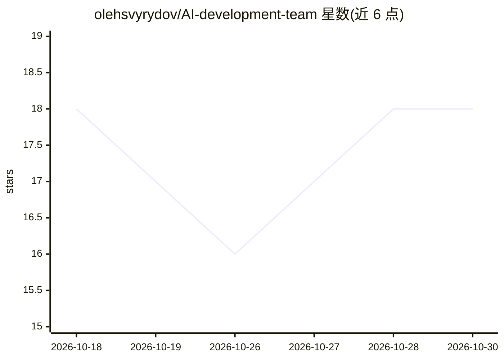

# olehsvyrydov/AI-development-team

⭐ 18 · Python · MIT · 推送 2026-10-18 · [GitHub](https://github.com/olehsvyrydov/AI-development-team) · 个人维护

**编辑器内 AI 开发团队框架：约 48 个角色 agent 与强制审批工作流**

面向开发者的可复用 AI agent 团队框架：43 个 agent 技能（15 人核心团队、按需加载的专家、自动加载的语言技能与流程技能）加 workflow-engine，按变更分类执行带审批门的比例化流程（solo/small-team/regulated 预设），门未通过可拒绝继续。以 Claude Code 插件形式安装，或经 install.sh 接入 Cursor、Kiro、VS Code（Copilot）。默认零付费账户，基于文件的工单与 markdown 知识库，Jira/Confluence 等为可选覆盖层。

## 筛选速览

| 维度 | 判定 | 备注 |
|---|---|---|
| AI 角色 | `ai-ecosystem` | LLM/agent 周边工具 |
| 许可风险 | `permissive` | MIT |
| 部署形态 | `library` | 以包/库形式分发 |
| 模型依赖 | — | README 未给出锁定关系 |
| 硬件要求 | — | 无带数字的原话,不猜 |
| 安装摩擦 | `medium` | 含编译或系统依赖之一 |
| 成熟度 | — | 结构信号不足 |

## 能力要点

- 15 个核心角色 + 按需专家 agent（/po /arch /rev /secops 等）
- workflow-engine 对每项变更分类并可拒绝跳过必需门禁
- 按 solo→small-team→regulated 预设做比例化流程
- Claude Code 插件或 install.sh 通用安装器，支持 4 种编辑器

## 适用场景

- 在编辑器中按角色化流程完成需求→架构→开发→评审→测试→验证
- 让引擎强制审批门禁，防止跳过评审或验证步骤
- 跨多个编辑器（Claude Code/Cursor/Kiro/VS Code）复用同一套 agent 层

## 场景标签

`编码 Agent` `代码审查` `多智能体` `Agent 框架` · 领域:Agent 开发

## 证据(README 行号)

> L5: > **A reusable AI agent-team framework for your editor.** 43 agent skills (a 15-agent core team + optional specialis
> L11: The framework is a portable agent layer you install once and use across every project. It ships four things:
> L16: - **Distribution** — a Claude Code **plugin** (declare it once per project; the commit SHA is the version, so every

## 星数曲线

2026-10-18 18 → 2026-10-30 18（+0）

---
*卡片 v1 · prompt 1.4 · 生成 2026-10-29 · 置信度 mid · 依据 README sha `4b4664211007` · [字段定义](../../DATASET.md)*
