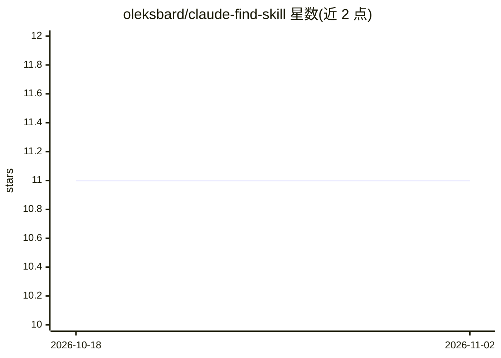

# oleksbard/claude-find-skill

⭐ 11 · MIT · 推送 2026-06-20 · [GitHub](https://github.com/oleksbard/claude-find-skill) · 个人维护

**Claude Code 技能：帮你搜索尚未安装的技能并给出前 5 推荐**

一个遵循标准 Agent Skill 格式（SKILL.md + YAML frontmatter）的 Claude Code 技能：用户以自然语言询问某类技能是否存在，它搜索官方插件市场、GitHub 与策展 awesome 清单，排除已安装项，按相关度与热度排序返回前 5 个带链接的匹配结果，并核验候选确实包含 SKILL.md。仅推荐、不安装。通过 git clone 复制到用户级技能目录安装；GitHub 代码搜索可经 gh auth login 获得更优结果，未认证时回退到公开 API 与网页搜索。

## 筛选速览

| 维度 | 判定 | 备注 |
|---|---|---|
| AI 角色 | `ai-ecosystem` | LLM/agent 周边工具 |
| 许可风险 | `permissive` | MIT |
| 部署形态 | `None` |  |
| 模型依赖 | — | README 未给出锁定关系 |
| 硬件要求 | — | 无带数字的原话,不猜 |
| 安装摩擦 | `low` | 无编译、无系统依赖或容器化 |
| 成熟度 | — | 结构信号不足 |

## 能力要点

- 聚合搜索官方插件市场、GitHub 与策展清单
- 排除已安装技能后按相关度与热度排序输出前 5 条
- 核验候选技能真实包含 SKILL.md
- 遵循 anthropics/skills 仓库文档的标准 Agent Skill 格式

## 适用场景

- 用一句话查找自己还没有的 Claude Code 技能
- 快速定位写变更日志、Terraform 审查等任务的现成技能

## 场景标签

 · 领域:AI 开发者工具/技能生态

## 证据(README 行号)

> L5: A Claude Code skill that **finds skills you don't have yet.**
> L7: Ask "is there a skill for X?" and it searches the official plugin marketplace, GitHub, and curated awesome-lists, th
> L9: > Built to the standard Agent Skill format — a folder with a `SKILL.md` and YAML frontmatter — as documented in Anth

## 星数曲线

2026-10-18 11 → 2026-11-02 11（+0）

---
*卡片 v1 · prompt 1.4 · 生成 2026-11-01 · 置信度 high · 依据 README sha `0c4b8414e3f6` · [字段定义](../../DATASET.md)*
