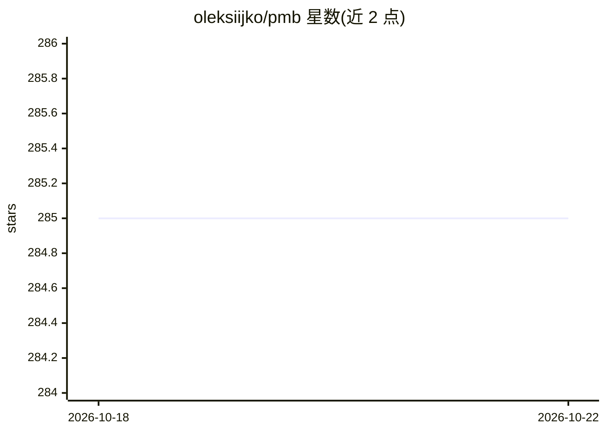

# oleksiijko/pmb

⭐ 284 · Python · Apache-2.0 · 推送 2026-09-23 · [GitHub](https://github.com/oleksiijko/pmb) · [官网](https://pypi.org/project/pmb-ai/) · 个人维护

**给 AI 编程 agent 的本地持久记忆 MCP 服务器**

面向 Claude Code、Cursor、Codex 等 MCP-aware 编程 agent 的持久记忆层：将决策、教训、个人事实、项目结构等存入本地 SQLite（ LanceDB 存可重建向量索引），通过 MCP 工具（prepare/recall 等 28 个）读回；BM25+向量+实体图经 RRF 融合检索，读路径无 LLM 调用，暖态召回约 35 ms。通过协议级 hooks 在模型思考前自动注入记忆，并在 Stop 时确定性核验教训是否被遵循；默认嵌入模型支持 50+ 语言，含约 450 MB 模型预热。提供本地仪表盘、快照备份与 Markdown/JSON 导出，Apache 2.0，可选 HTTP 团队模式。

## 筛选速览

| 维度 | 判定 | 备注 |
|---|---|---|
| AI 角色 | `ai-ecosystem` | LLM/agent 周边工具 |
| 许可风险 | `permissive` | Apache-2.0 |
| 部署形态 | `desktop` | 安装包/桌面程序 |
| 模型依赖 | — | README 未给出锁定关系 |
| 硬件要求 | — | 无带数字的原话,不猜 |
| 安装摩擦 | `low` | 无编译、无系统依赖或容器化 |
| 成熟度 | — | 结构信号不足 |

## 能力要点

- SQLite 为持久层、LanceDB 为可重建向量索引的本地工作区，读路径无 LLM 调用
- 协议级 hooks：UserPromptSubmit 自动召回、PostToolUse 环境观察、Stop 遵循核验与自动写入
- BM25+稠密向量+实体图+可选重排，经 Reciprocal-Rank-Fusion 融合
- 教训遵循率统计（USEFUL/UNVERIFIED/DEAD）与本地九标签仪表盘

## 适用场景

- 让编程 agent 跨会话记住项目决策与教训，不必重复解释
- 同一工作区被多个 agent（Claude Code/Cursor 等）共享读写
- 通过仪表盘查看实体图谱与教训实际生效情况

## 场景标签

`Agent 记忆` · 领域:Agent 开发

## 证据(README 行号)

> L31: PMB gives Claude Code, Cursor, Codex and the other MCP-aware agents a real
> L156:     A[Your agent] -->|MCP stdio| B[PMB MCP server]
> L161: - **Storage** - every durable event lives in SQLite, the source of truth. Rebuildable vector indexes live in Lance

## 星数曲线

2026-10-18 285 → 2026-10-22 285（+0）

---
*卡片 v1 · prompt 1.4 · 生成 2026-10-22 · 置信度 high · 依据 README sha `876ae56c5c6a` · [字段定义](../../DATASET.md)*
