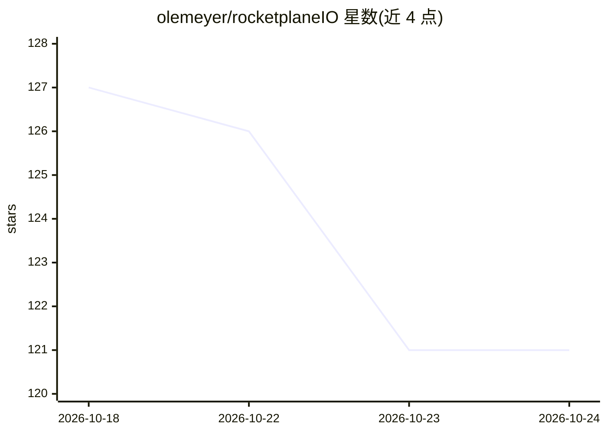

# olemeyer/rocketplaneIO

⭐ 120 · Go · Apache-2.0 · 推送 2026-07-29 · [GitHub](https://github.com/olemeyer/rocketplaneIO) · 个人维护

**自托管的 Kubernetes 全栈可观测平台，为 AI agent 提供带防护的 MCP 操作接口**

面向平台/SRE 团队的自托管 Kubernetes 可观测与操作平台：通过一个出站 agent 与 eBPF（Beyla/OTel）DaemonSet 采集日志、链路、指标与拓扑，零代码埋点；ClickHouse 存储并内嵌 Prometheus 引擎执行 PromQL。不自带 AI，而是向外部 agent（Claude Code、Cursor 等 MCP 客户端）暴露 MCP 接口，变更全部运行在事务内：变更前快照、风险分级、高危操作需人工审批、LIFO 回滚与全程审计。单命令脚本安装 compose 包，处于 Alpha、API 可能变动。

## 筛选速览

| 维度 | 判定 | 备注 |
|---|---|---|
| AI 角色 | `ai-ecosystem` | LLM/agent 周边工具 |
| 许可风险 | `permissive` | Apache-2.0 |
| 部署形态 | `self-host` | docker 或自建部署 |
| 模型依赖 | — | README 未给出锁定关系 |
| 硬件要求 | — | 无带数字的原话,不猜 |
| 安装摩擦 | `low` | 无编译、无系统依赖或容器化 |
| 成熟度 | `idea` | |

## 能力要点

- eBPF 零埋点采集 HTTP/gRPC/SQL/Redis/Kafka 链路，含跨服务上下文传播
- 外部 AI agent 经 MCP 通过 kubectl 形态原语操作任意资源（含 CRD）
- 事务防护：变更前快照、风险分级、高危操作人工审批、LIFO 回滚
- 支持离线部署（air-gapped），遥测数据不出自有基础设施

## 适用场景

- 让现有 AI agent 在受审批与回滚保护下排查并修复 K8s 问题
- 零埋点获取服务间调用链、日志与拓扑的统一可观测视图
- 告警触发自动修复工作流并全程留痕可回滚

## 场景标签

 · 领域:云原生可观测性/运维

## 证据(README 行号)

> L47: doesn't ship its own AI — it's the **MCP interface** your existing agent (Claude Code, Cursor,
> L209: The MCP endpoint lives in the control plane (`/mcp/orgs/{org}/clusters/{cluster}`, Streamable

## 星数曲线

2026-10-18 127 → 2026-10-24 121（-6）

---
*卡片 v1 · prompt 1.4 · 生成 2026-10-23 · 置信度 mid · 依据 README sha `dd5aa2e15dec` · [字段定义](../../DATASET.md)*
