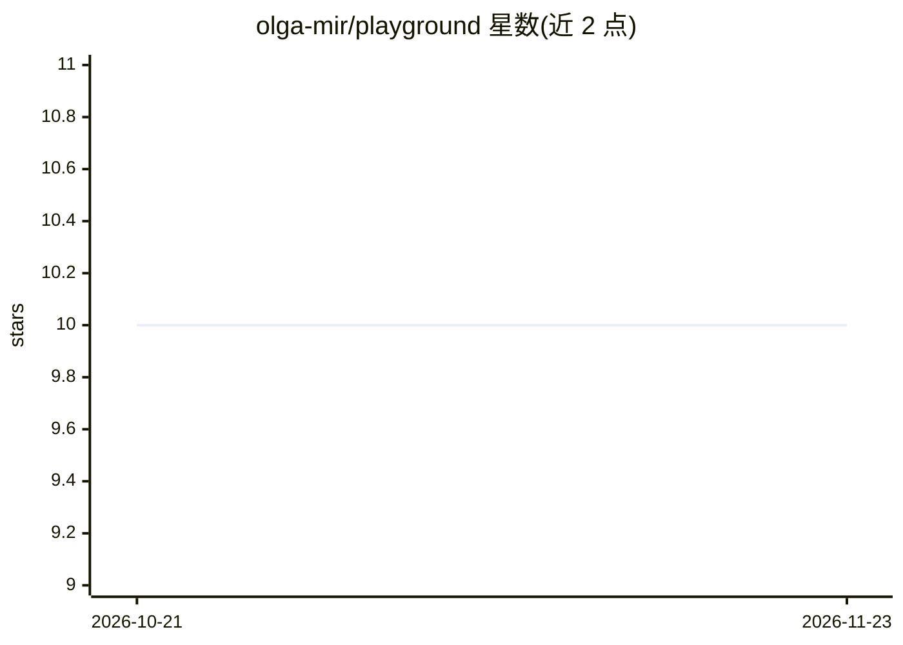

# olga-mir/playground

⭐ 10 · Python · Apache-2.0 · 推送 2026-09-25 · [GitHub](https://github.com/olga-mir/playground) · 个人维护

**基于 Crossplane 与 GitOps 的平台工程实验场，含 AI agent 部署**

一个 monorepo 演示项目：用 Crossplane v2 以 Kubernetes API 抽象方式供给 GKE 集群，用 FluxCD 做 GitOps 自动化部署，形成 hub-and-spoke 三集群架构（kind 引导 → GKE 控制面 → 租户工作负载集群）。技术栈还包含 kgateway、Agent Gateway（MCP/A2A）、kagent（K8s 内部署管理 AI agent 的框架）、LitmusChaos 与 kguardian。面向想探索基础设施即代码、AI agent 与 Kubernetes 工具交集的平台工程师；运行需 GCP 账号及 gcloud/flux/kubectl/task/Claude Code 等工具。

## 筛选速览

| 维度 | 判定 | 备注 |
|---|---|---|
| AI 角色 | `ai-ecosystem` | LLM/agent 周边工具 |
| 许可风险 | `permissive` | Apache-2.0 |
| 部署形态 | `None` |  |
| 模型依赖 | — | README 未给出锁定关系 |
| 硬件要求 | — | 无带数字的原话,不猜 |
| 安装摩擦 | `low` | 无编译、无系统依赖或容器化 |
| 成熟度 | — | 结构信号不足 |

## 能力要点

- Crossplane v2 直接命名空间作用域 XR 供给 GKE 集群，无 claims
- Flux GitOps + Flux Operator + GitHub Actions 触发的引导自动化
- kagent 框架在 Kubernetes 内部署与管理 AI agent，Agent Gateway 支持 MCP/A2A
- task setup:deploy 幂等部署脚本，可从部分失败后恢复

## 适用场景

- 搭建跨多集群的平台工程试验环境
- 在 Kubernetes 上试验 AI agent 的部署与管理
- 演练 GitOps 与基础设施即代码的组合流程

## 场景标签

`工作流自动化` · 领域:效率与自动化

## 证据(README 行号)

> L6: A monorepo showcasing modern cloud-native and AI-powered workflows. Built on **Crossplane v2** for platform API abst
> L19: ||kagent|Kubernetes-native AI agent framework that enables the deployment and management of AI agents within Kubern

## 星数曲线

2026-10-21 10 → 2026-11-23 10（+0）

---
*卡片 v1 · prompt 1.4 · 生成 2026-11-19 · 置信度 mid · 依据 README sha `943e7707cfed` · [字段定义](../../DATASET.md)*
