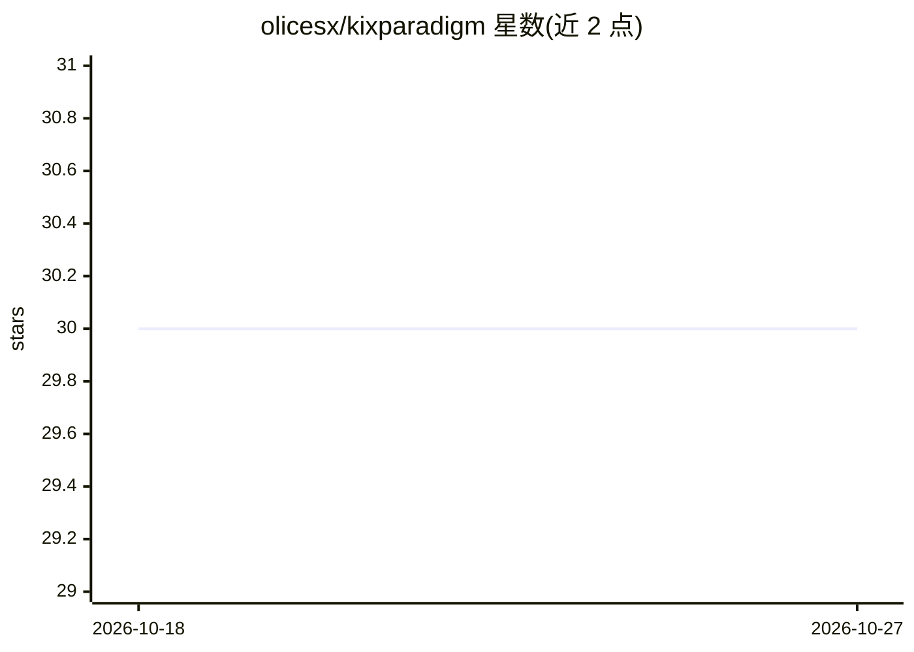

# olicesx/kixparadigm

⭐ 30 · JavaScript · MIT · 推送 2026-10-02 · [GitHub](https://github.com/olicesx/kixparadigm) · 个人维护 · 中文 README

**面向 DeepSeek Harness 的 AI 编码 Agent 预设与多智能体编排范式**

将 kix 范式打包为可复现的公开资产：npm 全局安装即导入 DeepSeek Harness（DSH）的 agent preset，含默认激励面（压缩思考锚点 + 效用准则 + 按需技能货架）与经典全文模式两个变体，另提供 VS Code Copilot 脚本安装的分发版。能力面覆盖认知层规范、kixpower 多智能体编曲（主模型自由挑选 dev/qa/reviewer 成员）、机械门禁插件（commit 预算、危险操作拦截）、browser 插件（playwright-core 直驱 + CDP 接管真实浏览器）与成本路由。机制细节外链至 DSH-ADAPTATION.md 等文档，README 不重复维护。

## 筛选速览

| 维度 | 判定 | 备注 |
|---|---|---|
| AI 角色 | `ai-ecosystem` | LLM/agent 周边工具 |
| 许可风险 | `permissive` | MIT |
| 部署形态 | `library` | 以包/库形式分发 |
| 模型依赖 | — | README 未给出锁定关系 |
| 硬件要求 | — | 无带数字的原话,不猜 |
| 安装摩擦 | `low` | 无编译、无系统依赖或容器化 |
| 成熟度 | — | 结构信号不足 |

## 能力要点

- npm 一键导入 DeepSeek Harness，双变体（激励面/经典）同装
- kixpower 编曲模型：主模型自由挑选成员 + DAG 拓扑 + 4 层 loop
- 机械门禁插件：commit 预算、feature branch、危险 SQL 拦截
- kix-browser：playwright-core 直驱 + CDP attach 接管真实浏览器（保留登录态）

## 适用场景

- 为 DeepSeek Harness 导入一套编码 Agent 预设与工作流规范
- 在 VS Code Copilot 中使用 kix 范式的技能与多智能体编排
- 通过门禁插件约束团队的分支与提交操作

## 场景标签

`编码 Agent` `多智能体` `浏览器自动化` · 领域:Agent 开发

## 证据(README 行号)

> L3: > **AI 自编排最小范式（认知层常驻）× 多智能体编排 × 编码 Agent 预设** — 一个仓库装下 kix 全家桶，`npm` 一键导入 DeepSeek Harness，脚本导入 VS Code Copilot。
> L15: kix 范式原是 VS Code Copilot 定制包。研究 DeepSeek Harness（DSH）后发现两者**机制天然适配**：常驻认知 = preset persona、门禁 hooks = `tools/pre-ex
> L22: npm i -g kixparadigm     # 同时安装默认模式 kixparadigm + 经典模式 kixparadigm-classic + vision-bridge；重启 dsh web 后在模式列表选择

## 星数曲线

2026-10-18 30 → 2026-10-27 30（+0）

---
*卡片 v1 · prompt 1.4 · 生成 2026-10-26 · 置信度 high · 依据 README sha `183d277c501b` · [字段定义](../../DATASET.md)*
