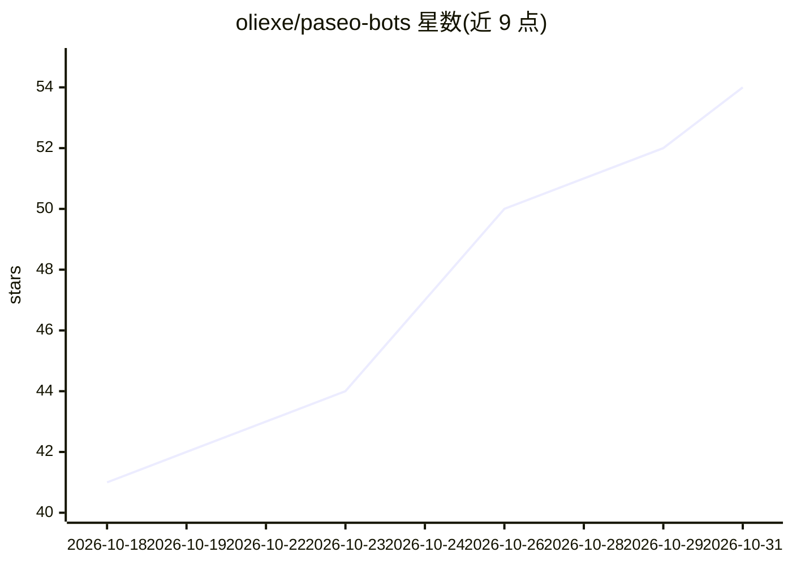

# oliexe/paseo-bots

⭐ 54 · TypeScript · MIT · 推送 2026-09-28 · [GitHub](https://github.com/oliexe/paseo-bots) · [官网](https://www.npmjs.com/package/@oliexe/paseo-bots) · 个人维护

**Paseo 的个人 AI bot 插件：创建带记忆与技能的像素 bot**

作为 Paseo（0.9.2+）的插件安装：用户可创建多个 bot，为每个 bot 配置指令、模型 provider、审批模式与头像；bot 通过 MEMORY.md 保持记忆并记录每日聊天日志；支持定时/webhook 例行任务、多 bot 团队（Chief of Staff 分派任务）、从 GitHub 导入技能、从 Claude Code/Desktop/Cursor 导入 MCP 服务器、通过 Composio 接入 1,000+ 应用，以及 /learn 把任务经验写成技能。Composio API key 保留在 Paseo 主机，bot 经本地中继受限访问。

## 筛选速览

| 维度 | 判定 | 备注 |
|---|---|---|
| AI 角色 | `ai-native` | 本体是模型或模型工具 |
| 许可风险 | `permissive` | MIT |
| 部署形态 | `None` |  |
| 模型依赖 | — | README 未给出锁定关系 |
| 硬件要求 | — | 无带数字的原话,不猜 |
| 安装摩擦 | `low` | 无编译、无系统依赖或容器化 |
| 成熟度 | — | 结构信号不足 |

## 能力要点

- 每个 bot 有可编辑的 MEMORY.md 记忆与每日日志
- 定时/一次性/webhook 触发的例行任务
- 多 bot 团队模式，由 Chief of Staff 分派请求
- 从 GitHub 导入技能、从 Claude Code/Desktop/Cursor 导入 MCP 服务器，经 Composio 接 1,000+ 应用

## 适用场景

- 创建承担邮件分拣、研究等角色的个人 AI bot 并与之对话
- 让 bot 按日程或 webhook 自动执行例行任务
- 组建 bot 团队协作处理复杂请求

## 场景标签

`AI 助手` `多智能体` · 领域:Agent 开发

## 证据(README 行号)

> L5: Personal bots for Paseo, like Grok Bot or Hermes Bots. Give each bot instructions, a model, memory, skills and tools
> L11: |**Bots**|Instructions, provider and model, host, approval mode and an avatar. Start blank or from a role such as E
> L34: paseo plugin install npm:@oliexe/paseo-bots

## 星数曲线

2026-10-18 41 → 2026-10-31 54（+13）

---
*卡片 v1 · prompt 1.4 · 生成 2026-10-25 · 置信度 high · 依据 README sha `649d51f6855d` · [字段定义](../../DATASET.md)*
