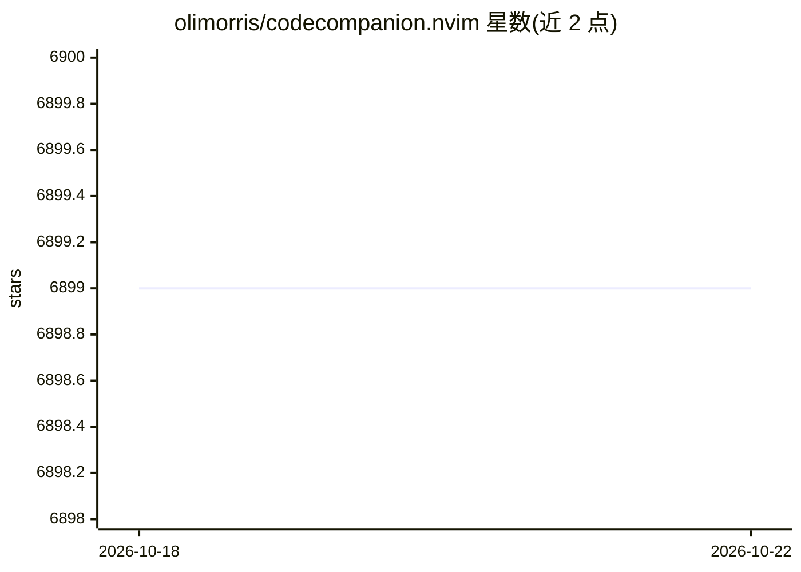

# olimorris/codecompanion.nvim

⭐ 6,899 · Lua · Apache-2.0 · 推送 2026-10-20 · [GitHub](https://github.com/olimorris/codecompanion.nvim) · [官网](https://codecompanion.olimorris.dev) · 个人维护

**Neovim 的 LLM/Agent 编程助手插件，接入多家模型与编码代理**

面向 Neovim 用户的 AI 编程助手插件：以聊天缓冲区、内联变换与重构方式与 LLM 协作，内置 Anthropic、OpenAI、Gemini、GitHub Copilot、DeepSeek、Ollama、OpenRouter 等适配器，也可自带适配器。支持 Agent Client Protocol 以接入 Claude Code、Codex、Gemini CLI 等编码代理，支持 MCP、代码审查、Slash 命令、技能与规则（CLAUDE.md/.cursor/rules）、图像与 PDF 输入及多会话并行。安装与配置详见其 docs，README 提供lazy.nvim 配置示例与 minimal.lua 排障方式。

## 筛选速览

| 维度 | 判定 | 备注 |
|---|---|---|
| AI 角色 | `ai-ecosystem` | LLM/agent 周边工具 |
| 许可风险 | `permissive` | Apache-2.0 |
| 部署形态 | `None` |  |
| 模型依赖 | local-ok | 支持本地模型 |
| 硬件要求 | — | 无带数字的原话,不猜 |
| 安装摩擦 | `low` | 无编译、无系统依赖或容器化 |
| 成熟度 | — | 结构信号不足 |

## 能力要点

- 内置多家 LLM 适配器（Anthropic/OpenAI/Gemini/Copilot/Ollama 等）并支持自带适配器
- 通过 ACP 接入 Claude Code、Codex、Gemini CLI 等编码代理
- 支持 MCP、代码审查、内联变换与重构、Slash 命令与工作流
- 支持图像和 PDF 输入、多聊天并行与异步执行

## 适用场景

- 在 Neovim 内以对话方式完成编码、重构与代码生成
- 让编码代理（Claude Code/Codex 等）在编辑器中执行任务并审查其改动
- 通过自定义提示词、规则和 MCP 工具扩展工作流

## 场景标签

`编码 Agent` `代码生成` `代码审查` `提示工程` · 领域:Agent 开发

## 证据(README 行号)

> L3:  A Neovim AI coding assistant for coding with LLMs (Anthropic, OpenAI, Gemini, Copilot and more) and AI agents. With
> L18: - :zap: Integrates Neovim with LLMs and Agents in the CLI

## 星数曲线

2026-10-18 6,899 → 2026-10-22 6,899（+0）

---
*卡片 v1 · prompt 1.4 · 生成 2026-10-20 · 置信度 high · 依据 README sha `f7a7892f2319` · [字段定义](../../DATASET.md)*
