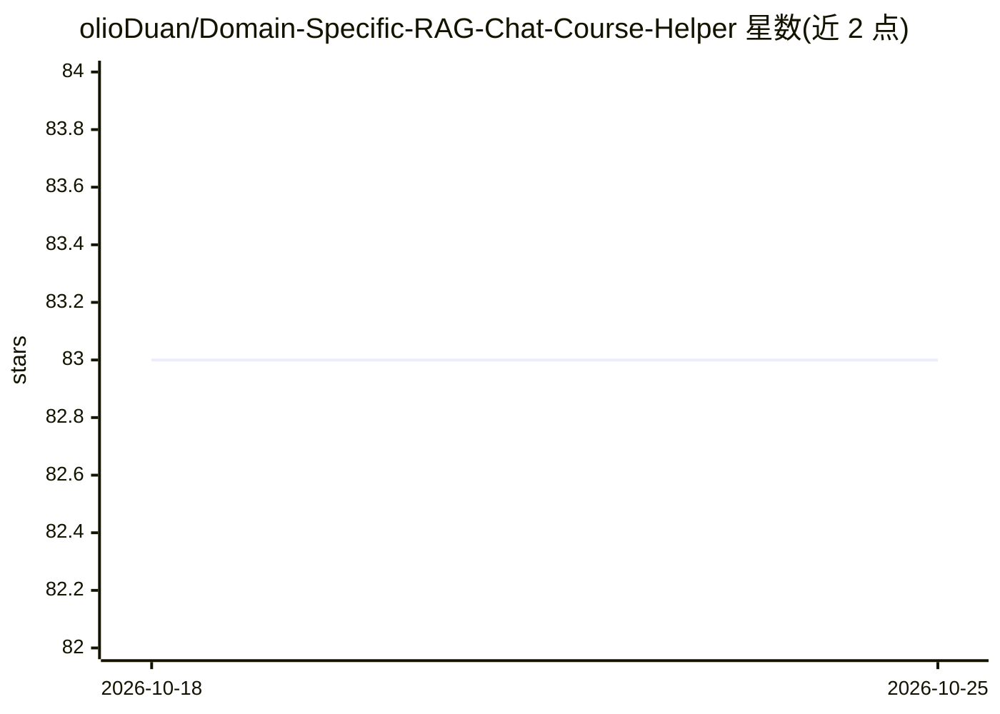

# olioDuan/Domain-Specific-RAG-Chat-Course-Helper

⭐ 83 · Python · Apache-2.0 · 推送 2025-12-28 · [GitHub](https://github.com/olioDuan/Domain-Specific-RAG-Chat-Course-Helper) · 个人维护

**面向 NYU 机器学习课程的本地 RAG 课件问答与自测助手**

针对 NYU 6143 机器学习课程构建的本地 RAG 系统：将 15 份课程 PDF 按“一页一 chunk”切分并附加来源元数据，用 HuggingFace all-MiniLM-L6-v2 计算嵌入、FAISS 建索引，由 Ollama 本地运行的 deepseek-r1:8b 生成回答，回答附带 (Lec X, Slide Y) 引用；每次有效提问后还会生成一道带引用的选择题自测，并含安全检查（无关问题不出题）。附 Recall@K 检索评测、嵌入 PCA 可视化，Gradio 三页签 Web UI。全部组件本地运行，不依赖云 API。

## 筛选速览

| 维度 | 判定 | 备注 |
|---|---|---|
| AI 角色 | `ai-native` | 本体是模型或模型工具 |
| 许可风险 | `permissive` | Apache-2.0 |
| 部署形态 | `library` | 以包/库形式分发 |
| 模型依赖 | local-ok | 支持本地模型 |
| 硬件要求 | — | 无带数字的原话,不猜 |
| 安装摩擦 | `low` | 无编译、无系统依赖或容器化 |
| 成熟度 | — | 结构信号不足 |

## 能力要点

- 一页一 chunk 切分策略，回答附带 Lec X, Slide Y 级引用
- 嵌入/索引/生成全本地：all-MiniLM-L6-v2 + FAISS + Ollama deepseek-r1:8b
- 每次回答后生成带引用的四选一自测题，含无关问题安全检查
- 提供 Recall@K 检索评测脚本与嵌入 PCA 可视化

## 适用场景

- 基于课程课件回答问题并给出幻灯片出处
- 生成自测选择题辅助备考复习
- 对课程检索质量做 Recall@K 评测与嵌入结构可视化

## 场景标签

`RAG` `文档问答` · 领域:知识与检索

## 证据(README 行号)

> L11: This project is a Retrieval-Augmented Generation (RAG) system built for the NYU 6143 Machine Learning course. It tu
> L17: **All components run locally:** embeddings are computed with a HuggingFace model, the vector index is stored in FAI
> L156:  - A local LLM (`deepseek-r1:8b` via Ollama) receives `{question, context, chat_history}` and generates an answer 

## 星数曲线

2026-10-18 83 → 2026-10-25 83（+0）

---
*卡片 v1 · prompt 1.4 · 生成 2026-10-24 · 置信度 high · 依据 README sha `4a15ddca7897` · [字段定义](../../DATASET.md)*
