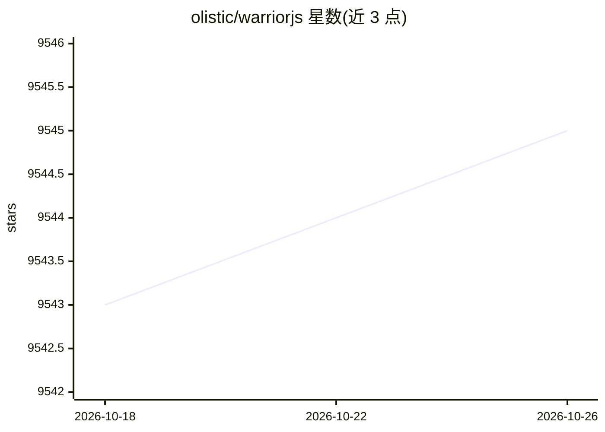

# olistic/warriorjs

⭐ 9,545 · TypeScript · MIT · 推送 2026-03-27 · [GitHub](https://github.com/olistic/warriorjs) · [官网](https://warriorjs.com) · 个人维护

**通过写代码操控战士闯塔来学习 JavaScript/TypeScript 的编程游戏**

命令行编程游戏：玩家在 Player.js 中编写 JavaScript 或 TypeScript 代码，指挥战士在布满敌人与俘虏的塔层中闯关，代码即策略，无点击拖拽操作。每层生成带说明的 README，运行 warriorjs 命令执行解法并查看结果。提供 npm 安装的 CLI，也可在浏览器网页版游玩；需 Node.js 22 及以上，MIT 许可。面向学习 JS/TS 的开发者与编程学习者。

## 筛选速览

| 维度 | 判定 | 备注 |
|---|---|---|
| AI 角色 | `ai-enhanced` | 去掉 AI 部分产品仍成立 |
| 许可风险 | `permissive` | MIT |
| 部署形态 | `library` | 以包/库形式分发 |
| 模型依赖 | — | README 未给出锁定关系 |
| 硬件要求 | — | 无带数字的原话,不猜 |
| 安装摩擦 | `low` | 无编译、无系统依赖或容器化 |
| 成熟度 | — | 结构信号不足 |

## 能力要点

- 以 JS/TS 代码作为闯塔策略的解谜式玩法
- npm 全局安装 CLI，或浏览器端直接游玩
- 每层生成 README 说明与 Player.js 解法文件
- 官方文档覆盖玩法、塔与 Player API，支持自建塔

## 适用场景

- 通过游戏闯关练习 JavaScript/TypeScript 编程
- 从第一个 if 语句开始逐步学习编程逻辑
- 编写自定义塔层扩展玩法

## 场景标签

`教程课程` · 领域:学习与行业

## 证据(README 行号)

> L5:  Learn JavaScript and TypeScript by writing code that fights
> L14: In WarriorJS, you write JavaScript or TypeScript to guide a warrior through

## 星数曲线

2026-10-18 9,543 → 2026-10-26 9,545（+2）

---
*卡片 v1 · prompt 1.4 · 生成 2026-10-20 · 置信度 low · 依据 README sha `cdd810ac55ad` · [字段定义](../../DATASET.md)*
