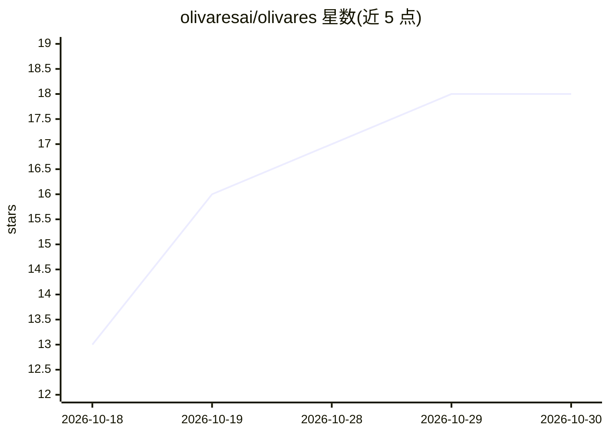

# olivaresai/olivares

⭐ 18 · Go · AGPL-3.0 · 推送 2026-10-26 · [GitHub](https://github.com/olivaresai/olivares) · [官网](https://olivares.ai) · 组织维护 · 中文 README

**企业 AI 工具的自托管治理平台：会话、权限、成本与审计一体化**

用 Go 编写的单二进制自托管服务，面向已使用 Claude Code、Codex 等编码工具的团队，提供 Web 控制台、CLI 与 REST/gRPC API。功能覆盖 agent/会话/MCP 工具清单盘点、访问映射、四个 deny-closed 执行点（动作前校验）、FinOps 预算、连接 Google Drive/Confluence/Notion 等数据源、跨会话任务记录与签名防篡改审计日志。声称 32 模块、136 集成，支持通过 Ollama 接入本地模型。社区版 AGPL-3.0 完整可用，另有付费 Business/Enterprise 版；状态标注 beta，无 Windows 原生构建。

## 筛选速览

| 维度 | 判定 | 备注 |
|---|---|---|
| AI 角色 | `ai-ecosystem` | LLM/agent 周边工具 |
| 许可风险 | `dual` | AGPL-3.0 |
| 部署形态 | `desktop` | 安装包/桌面程序 |
| 模型依赖 | local-ok | 支持本地模型 |
| 硬件要求 | — | 无带数字的原话,不猜 |
| 安装摩擦 | `low` | 无编译、无系统依赖或容器化 |
| 成熟度 | `idea` | |

## 能力要点

- 四个 deny-closed 执行点：Claude Code 内、模型代理、MCP 工具调用、agent 间
- 签名防篡改审计日志与 26 个合规框架目录映射（Business）
- FinOps 预算按团队/agent/模型预警或停止支出
- 单一 Go 二进制内置控制台，支持 Docker/包管理器/源码多种安装

## 适用场景

- 企业集中管控团队的 AI 编码工具会话与权限
- 在动作执行前施加审批与拒绝策略
- 追踪各团队/agent 的 AI 成本并设预算
- 为审计与合规提供签名证据记录与报告

## 场景标签

`LLM 可观测性` · 领域:评测与运维

## 证据(README 行号)

> L17: Olivares AI answers them in one place. It connects to the agents and tools you already use, shows what each one doe
> L44: - **Stop an action before it does damage.** Olivares AI has **four deny-closed enforcement points** that check each
> L50: It works with the tools you already have: Claude Code, Codex, Grok, Cursor, gemini-cli, opencode, OpenHands and loc

## 星数曲线

2026-10-18 13 → 2026-10-30 18（+5）

---
*卡片 v1 · prompt 1.4 · 生成 2026-10-29 · 置信度 high · 依据 README sha `3217029a40f0` · [字段定义](../../DATASET.md)*
