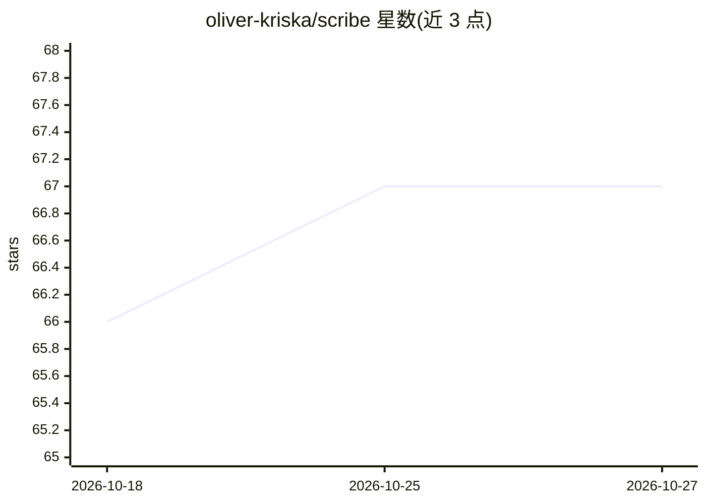

# oliver-kriska/scribe

⭐ 67 · Go · MIT · 推送 2026-10-26 · [GitHub](https://github.com/oliver-kriska/scribe) · [官网](https://getscribe.dev/) · 个人维护

**自动构建跨项目个人知识库的单二进制 CLI，供编码 agent 检索**

scribe 是 Go 编写的单二进制 CLI：从 git 仓库、ccrider 索引的编码 agent 会话（Claude Code、Codex CLI 等）、iMessage 书签和本地文件中提取可复用知识，经 LLM 编译为纯 markdown wiki，由 qmd 建索引供语义检索。LLM 步骤默认走 Anthropic Claude，也可切换到本地 Ollama（qwen3/gemma4/gemma3）实现免费离线运行。通过 cron 定时任务自动运行（提取、lint、去重、冲突消解、周度 Dream 整理等），并向 CLAUDE.md/AGENTS.md 写入指令块，使编码 agent 在会话中主动查询该知识库。安装提供 Homebrew、shell 安装脚本与源码编译（需 Go≥1.26 与 C 工具链）。

## 筛选速览

| 维度 | 判定 | 备注 |
|---|---|---|
| AI 角色 | `ai-native` | 本体是模型或模型工具 |
| 许可风险 | `permissive` | MIT |
| 部署形态 | `library` | 以包/库形式分发 |
| 模型依赖 | local-ok | 支持本地模型 |
| 硬件要求 | — | 无带数字的原话,不猜 |
| 安装摩擦 | `medium` | 含编译或系统依赖之一 |
| 成熟度 | — | 结构信号不足 |

## 能力要点

- 从 git 仓库与编码 agent 会话（ccrider FTS5 索引）自动提取知识
- 全流程可切换到本地 Ollama（qwen3/gemma4/gemma3）实现免费离线
- cron 驱动全自动维护：提取、lint、去重、别名聚类、周度整理
- 写入 CLAUDE.md/AGENTS.md 使 Claude Code/Codex/Amp 跨会话查询知识库
- 知识库为自有的 git markdown 仓库，可用 Obsidian/ripgrep 打开

## 适用场景

- 让 Claude Code/Codex 等编码 agent 在多个项目中复用我过往的决策与踩坑记录
- 把发给自己的 iMessage 链接和 Pinboard 收藏自动归档进可检索的 wiki
- 无需手动记笔记，自动积累跨项目可检索的个人知识库

## 场景标签

`知识库管理` · 领域:知识与检索

## 证据(README 行号)

> L3: `scribe` is a single-binary CLI that creates and maintains a personal, LLM-written knowledge base. It continuously e
> L7: **An LLM wiki, not a RAG pipeline.** scribe implements the LLM Wiki pattern Andrej Karpathy described, with the sour
> L13: **1. Claude Code, Codex CLI *and* Amp become *context-aware* across sessions.** `scribe init` writes a block into `

## 星数曲线

2026-10-18 66 → 2026-10-27 67（+1）

---
*卡片 v1 · prompt 1.4 · 生成 2026-10-24 · 置信度 mid · 依据 README sha `4033d17d4d7a` · [字段定义](../../DATASET.md)*
