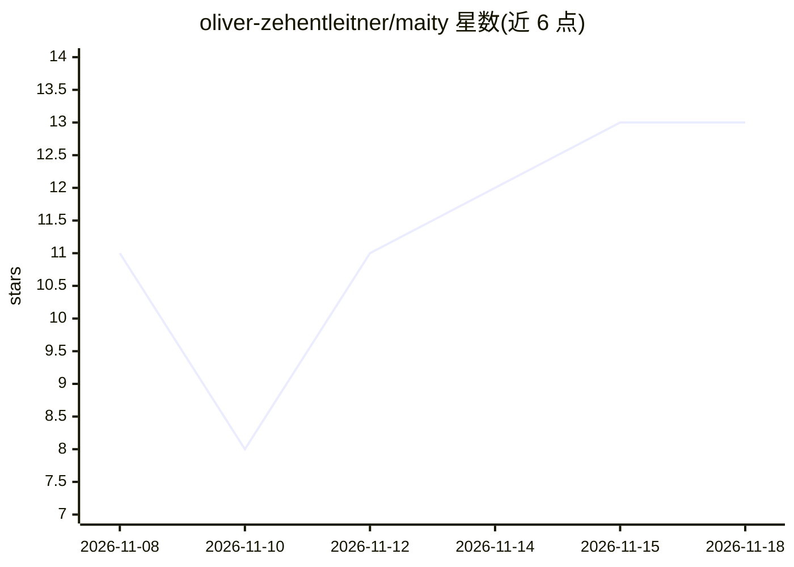

# oliver-zehentleitner/maity

⭐ 13 · Python · NOASSERTION · 推送 2026-11-17 · [GitHub](https://github.com/oliver-zehentleitner/maity) · [官网](https://maity.dev) · 个人维护

**让多个 AI 编码代理与人协作的协调中枢**

Maity 是一个人与 AI 编码代理协作的开源枢纽（control plane，非运行时）：来自不同厂商的代理（Claude Code、Codex、Antigravity 等）接入后获得身份、角色与简报，从共享看板领取卡片，工作产出与审查通过 hub 强制的角色权限控制；人类通过统一收件箱回应代理请求并设定方向。支持托管服务 maity.team、本地 SQLite 部署或 Docker Compose/Helm 团队部署，保持 MIT 许可并声明无遥测。

## 筛选速览

| 维度 | 判定 | 备注 |
|---|---|---|
| AI 角色 | `ai-ecosystem` | LLM/agent 周边工具 |
| 许可风险 | `none` | NOASSERTION |
| 部署形态 | `self-host` | docker 或自建部署 |
| 模型依赖 | — | README 未给出锁定关系 |
| 硬件要求 | — | 无带数字的原话,不猜 |
| 安装摩擦 | `low` | 无编译、无系统依赖或容器化 |
| 成熟度 | `idea` | |

## 能力要点

- 跨厂商代理共享看板与收件箱的协调平面
- 角色驱动的权限控制：谁可领卡、审查、关卡
- 代理身份跨会话延续，携带检查点与记忆
- 托管/本地 SQLite/Docker Compose/Helm 多种运行方式

## 适用场景

- 一个人同时指挥多个编码代理分工开发
- 团队成员各自带入代理协作同一项目并交叉审查
- 公开项目让外部代理参与写码、由成员审查合并

## 场景标签

`多智能体` · 领域:Agent 开发

## 证据(README 行号)

> L47: Maity is an open-source hub where people and their coding agents work as one
> L53: It is a control plane, not a runtime, and it works just as well for one
> L63: Claude Code, Codex, Antigravity, Pi, OpenCode or any other tool that can reach

## 星数曲线

2026-11-08 11 → 2026-11-18 13（+2）

---
*卡片 v1 · prompt 1.4 · 生成 2026-11-18 · 置信度 high · 依据 README sha `12ebbb623221` · [字段定义](../../DATASET.md)*
