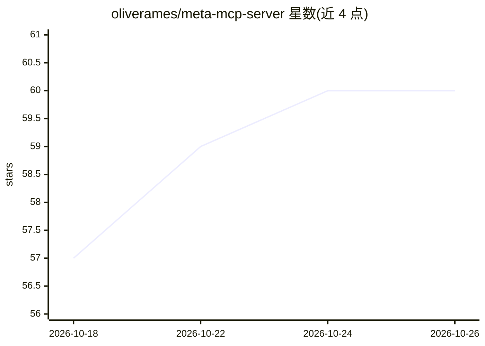

# oliverames/meta-mcp-server

⭐ 60 · TypeScript · MIT · 推送 2026-10-25 · [GitHub](https://github.com/oliverames/meta-mcp-server) · [官网](https://www.npmjs.com/package/meta-mcp-server) · 个人维护

**连接 AI 助手与 Meta 商业平台的 MCP 服务器（199 工具）**

将 Meta Graph API v21.0 的多个平台（Facebook Pages、Instagram、Threads、Ads Manager、Commerce、Conversions API 等）封装为单一 MCP 接口，供 Claude Desktop 等 MCP 客户端的 AI 助手调用。提供 199 个工具，覆盖内容发布与跨平台发帖、评论与私信互动管理、多层级的 Insights 数据分析、广告投放全流程、商品目录管理、直播、公共 Ad Library 竞品查询以及 token/权限/限流诊断。通过 MCPB 捆绑包或 npm 从源码构建安装，使用需自备 Meta 访问 token。

## 筛选速览

| 维度 | 判定 | 备注 |
|---|---|---|
| AI 角色 | `ai-ecosystem` | LLM/agent 周边工具 |
| 许可风险 | `permissive` | MIT |
| 部署形态 | `library` | 以包/库形式分发 |
| 模型依赖 | — | README 未给出锁定关系 |
| 硬件要求 | — | 无带数字的原话,不猜 |
| 安装摩擦 | `low` | 无编译、无系统依赖或容器化 |
| 成熟度 | — | 结构信号不足 |

## 能力要点

- 覆盖 7 个 Meta 平台的 199 个工具（Graph API v21.0）
- 广告全生命周期：A/B 测试、Advantage+ 迁移、定向搜索、CAPI 服务端转化
- Insights 分析覆盖 70+ 页面指标与 Reels 跳过率等指标
- 错误信息包含修复指引（token 再生成链接、缺失权限定位）

## 适用场景

- 让 AI 助手在一个对话中代管 Facebook/Instagram/Threads 的发布与互动
- 用自然语言查询广告投放与内容表现数据
- 管理商品目录并监控 token、权限与限流状态

## 场景标签

`数据分析` · 领域:效率与自动化

## 证据(README 行号)

> L5:  Connect any AI assistant to Meta's entire business platform
> L26: Social media management across Meta's platforms — Facebook Pages, Instagram, Threads, Ads Manager, Commerce — requi

## 星数曲线

2026-10-18 57 → 2026-10-26 60（+3）

---
*卡片 v1 · prompt 1.4 · 生成 2026-10-24 · 置信度 high · 依据 README sha `8287781e9024` · [字段定义](../../DATASET.md)*
