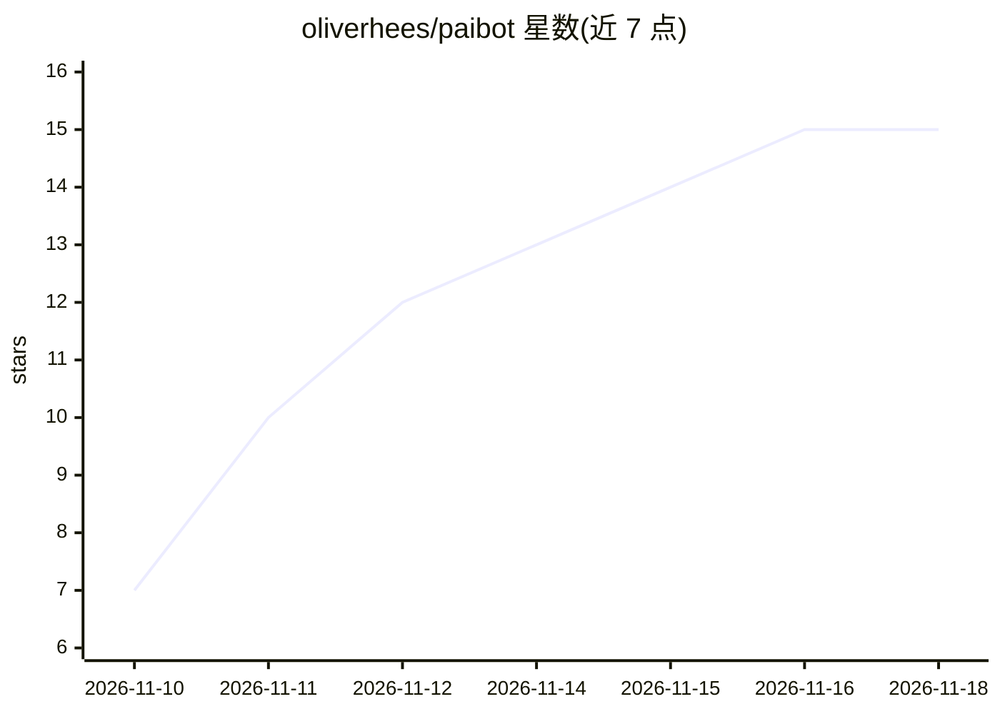

# oliverhees/paibot

⭐ 15 · TypeScript · NOASSERTION · 推送 2026-11-15 · [GitHub](https://github.com/oliverhees/paibot) · [官网](https://paibot.de) · 个人维护

**自托管个人 KI-Agent 团队：本地/EU 模型+数据脱敏闸门**

面向个人用户的 KI-Agent 项目（Personal AI Bot）：多个带角色与记忆的 Bots 组成团队，互相委派任务，可自行浏览网页并通过 MCP 接入应用，外发或写操作需用户批准。模型通道支持 EU 模型（EUrouter）、自建 vLLM、本地 LM Studio/Ollama，均 OpenAI 兼容；可开关的 Datenschleuse 在数据到达模型前把姓名、邮箱、IBAN 替换为占位符并在回复中还原。技术栈 Next.js+Postgres，Fair-Code 许可仅限私人使用；目前处于 Folge 0 阶段，功能列表均为'geplant'，快速启动仅运行骨架，需 Node.js 22 与 pnpm 10 源码运行。

## 筛选速览

| 维度 | 判定 | 备注 |
|---|---|---|
| AI 角色 | `ai-native` | 本体是模型或模型工具 |
| 许可风险 | `none` | NOASSERTION |
| 部署形态 | `library` | 以包/库形式分发 |
| 模型依赖 | local-ok | 支持本地模型 |
| 硬件要求 | — | 无带数字的原话,不猜 |
| 安装摩擦 | `low` | 无编译、无系统依赖或容器化 |
| 成熟度 | `idea` | |

## 能力要点

- 多 Bot 团队：角色分工、任务委派、Chief of Staff（规划中）
- Datenschleuse 在请求前掩蔽个人数据（姓名/邮箱/IBAN），回复中还原
- 模型通道：EU 模型 / vLLM / LM Studio / Ollama，均 OpenAI 兼容
- 最小权限：每个 Bot 仅获所需权限，外部动作等待用户批准

## 适用场景

- 在自己的服务器或本机运行一组私人 KI 助手处理日常任务
- 让 Bots 代替自己浏览网页、操作已接入的应用并在批准下执行
- 使用本地模型（Ollama/LM Studio）保证请求不出本机

## 场景标签

`多智能体` `浏览器自动化` `AI 助手` · 领域:Agent 开发

## 证据(README 行号)

> L18: **Paibot** (Personal AI Bot) ist ein persönlicher KI-Agent für die private Nutzung – nicht ein einzelner Chatbot, s
> L31: |**Welche KI?**|EU-Modelle über EUrouter, eigene Modelle über vLLM, lokal über LM Studio oder Ollama – alles OpenAI

## 星数曲线

2026-11-10 7 → 2026-11-18 15（+8）

---
*卡片 v1 · prompt 1.4 · 生成 2026-11-18 · 置信度 low · 依据 README sha `b121c2848c39` · [字段定义](../../DATASET.md)*
