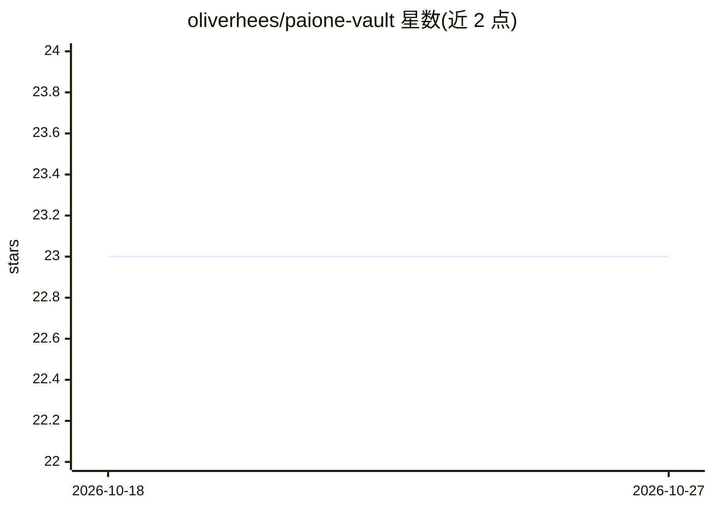

# oliverhees/paione-vault

⭐ 23 · Shell · MIT · 推送 2026-04-23 · [GitHub](https://github.com/oliverhees/paione-vault) · [官网](https://youtube.com/@aiianer) · 个人维护

**自托管的 Markdown+Git AI 工作操作系统启动模板**

面向个体创业者与小团队的 self-hosted AI-Betriebssystem 基础仓库（Starter）：以单个 Git 仓库中的 Markdown 承载项目、笔记、知识与 agent 记忆，替代多个 SaaS 工具。本仓库提供 10 个顶层目录结构、SPEC.md、JSON-Schemas、模板、pre-commit hook 与安装脚本；生态中另有 PM（Next.js 看板）、Brain（采集+Cognee RAG）、Agent（Hermes+MCP 接入 Vault）、Client 等独立模块仓库。运行仅需 Git、Python 与文本编辑器，推荐 Forgejo 托管，声明 DSGVO 就绪、MIT 许可。

## 筛选速览

| 维度 | 判定 | 备注 |
|---|---|---|
| AI 角色 | `ai-knowledge` | 知识聚合/清单类 |
| 许可风险 | `permissive` | MIT |
| 部署形态 | `None` |  |
| 模型依赖 | — | README 未给出锁定关系 |
| 硬件要求 | — | 无带数字的原话,不猜 |
| 安装摩擦 | `low` | 无编译、无系统依赖或容器化 |
| 成熟度 | `idea` | |

## 能力要点

- 单 Git 仓库 Markdown 结构：10 个顶层目录 + SPEC.md + JSON-Schemas + pre-commit hook
- 提供 setup.sh 自动安装（5 分钟）与分步文档两条路径
- 生态模块规划：PM / Brain（Cognee RAG）/ Agent（Hermes+MCP）/ Client
- 无 Docker/Node/数据库依赖，仅需 Git、Python 与文本编辑器

## 适用场景

- 在自己的服务器上搭建集中管理项目、笔记与 agent 记忆的 Vault
- 作为 PAIONE 各功能模块的基础结构起点
- 按 DSGVO 要求以自托管方式管理数据

## 场景标签

`知识库管理` `Agent 记忆` · 领域:Agent 开发

## 证据(README 行号)

> L11: PAIONE ist ein self-hosted AI-Betriebssystem für Solopreneure und kleine Teams. Statt deine Arbeit auf fünf SaaS-To
> L19: - **AI-native** — Agents wie Claude, Hermes, Mission Control verstehen Markdown nativ
> L76: - **PAIONE Brain** — Capture-Pipeline (URL/YouTube/Voice/PDF → Markdown) + Cognee als RAG-Layer

## 星数曲线

2026-10-18 23 → 2026-10-27 23（+0）

---
*卡片 v1 · prompt 1.4 · 生成 2026-10-27 · 置信度 mid · 依据 README sha `d49ebbc0ea09` · [字段定义](../../DATASET.md)*
