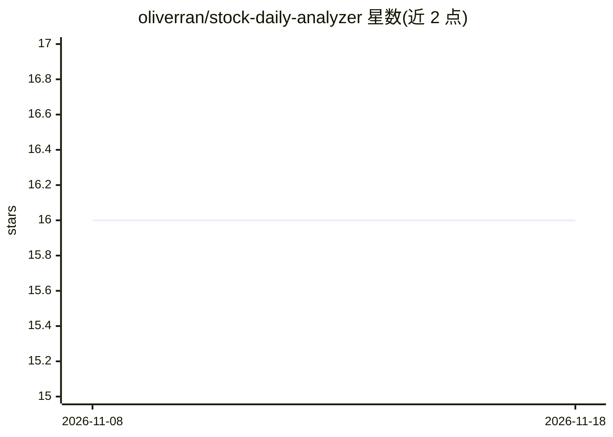

# oliverran/stock-daily-analyzer

⭐ 16 · Python · MIT · 推送 2026-11-14 · [GitHub](https://github.com/oliverran/stock-daily-analyzer) · 个人维护 · 中文 README

**A股技术信号扫描、研究日报与组合回测的 Python 工具**

面向 A 股量化研究的 Python CLI 工具：按放量突破、趋势向好、超卖反弹等规则扫描候选股并生成文本日报，历史记录存入 SQLite；另含独立量化框架 qf，覆盖因子计算、截面打分、TopK 组合、周频调仓回测。提供无需 API Key 的离线演示（合成数据），接入真实数据默认使用 AkShare/yfinance，回测行情适配器目前仅支持 yfinance。可选功能为通过火山方舟兼容接口的 LLM 新闻与候选股解读。提供 CLI、Docker/systemd 部署示例及 Colab Notebook。

## 筛选速览

| 维度 | 判定 | 备注 |
|---|---|---|
| AI 角色 | `ai-enhanced` | 去掉 AI 部分产品仍成立 |
| 许可风险 | `permissive` | MIT |
| 部署形态 | `desktop` | 安装包/桌面程序 |
| 模型依赖 | — | README 未给出锁定关系 |
| 硬件要求 | — | 无带数字的原话,不猜 |
| 安装摩擦 | `low` | 无编译、无系统依赖或容器化 |
| 成熟度 | — | 结构信号不足 |

## 能力要点

- 每日扫描生成文本日报，历史记录存 SQLite
- qf 框架：因子计算→截面打分→TopK 等权组合→周频调仓回测
- 离线演示使用合成数据，无需 API Key 与联网
- 可选 LLM 候选股解读（火山方舟或兼容接口）

## 适用场景

- 每日扫描 A 股技术信号并生成研究日报
- 用合成数据离线验证回测流程后再接入真实数据
- 运行 TopK 因子组合回测并导出净值、持仓与指标

## 场景标签

`金融量化` · 领域:学习与行业

## 证据(README 行号)

> L7: 用 Python 扫描 A 股技术信号、生成研究日报，并通过独立的量化框架运行日频回测。LLM 新闻分析与候选股解读是可选功能。
> L36: - **可选 LLM 分析**：通过火山方舟或兼容接口，结合新闻、基本面和历史异动信息生成候选股解读。需要自行配置服务凭据，可能产生 API 费用。

## 星数曲线

2026-11-08 16 → 2026-11-18 16（+0）

---
*卡片 v1 · prompt 1.4 · 生成 2026-11-18 · 置信度 high · 依据 README sha `058ae64c4c71` · [字段定义](../../DATASET.md)*
