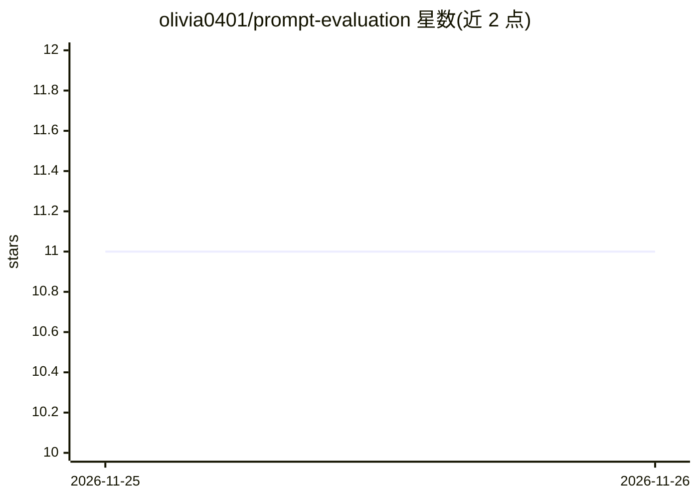

# olivia0401/prompt-evaluation

⭐ 11 · Python · MIT · 推送 2026-11-17 · [GitHub](https://github.com/olivia0401/prompt-evaluation) · 个人维护

**面向开发者的 prompt/模型配对评估流水线**

对 23 个客户 brief 上的 prompt recipe 与 LLM 进行可复现的配对评估，输出任务分数、重跑噪声、配对统计比较及源数据审计（32 项审计检查）。按 stage（phase0/stage_a/stage_b/phase4）运行实验脚本， stages 会产生付费 API 调用，需在 src/config.py 中设置预算与 provider。另提供 FastAPI 服务（uvicorn 启动）与 CI 回归门禁。限制：模型比较未做多重比较校正，真实 briefs.yml 未随仓库发布。

## 筛选速览

| 维度 | 判定 | 备注 |
|---|---|---|
| AI 角色 | `ai-ecosystem` | LLM/agent 周边工具 |
| 许可风险 | `permissive` | MIT |
| 部署形态 | `library` | 以包/库形式分发 |
| 模型依赖 | — | README 未给出锁定关系 |
| 硬件要求 | — | 无带数字的原话,不猜 |
| 安装摩擦 | `low` | 无编译、无系统依赖或容器化 |
| 成熟度 | — | 结构信号不足 |

## 能力要点

- 23 briefs × 多 recipe × 多模型的配对显著性比较，以 brief 数为独立样本量
- 分阶段实验脚本，输出各阶段结果与审计结果
- FastAPI 服务形态，通过 pip 安装 requirements-service.txt 启动
- CI 回归门禁使用固定任务配置与实测重跑噪声

## 适用场景

- 比较不同 prompt recipe 与模型在同一批 brief 上的表现差异
- 为 prompt 变更建立回归门禁防止质量回退
- 对评估用黄金数据做审计与证据边界核查

## 场景标签

`提示工程` `模型评测` · 领域:Agent 开发

## 证据(README 行号)

> L3: Reproducible paired evaluation of prompt recipes and LLMs across 23 client briefs. It reports task scores, rerun noi
> L19: uvicorn service.api:app --reload

## 星数曲线

2026-11-25 11 → 2026-11-26 11（+0）

---
*卡片 v1 · prompt 1.4 · 生成 2026-11-24 · 置信度 high · 依据 README sha `38f9d91a907e` · [字段定义](../../DATASET.md)*
