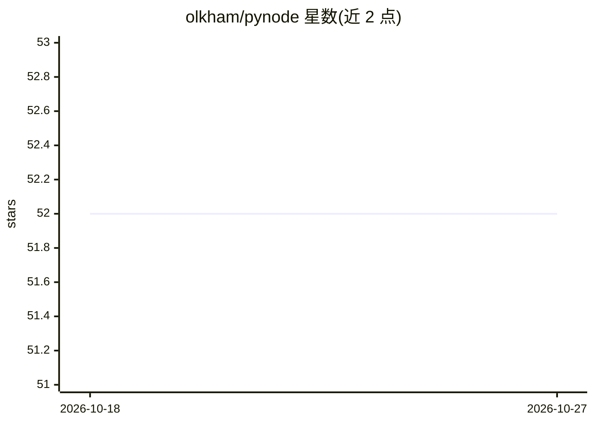

# olkham/pynode

⭐ 52 · Python · MIT · 推送 2026-10-22 · [GitHub](https://github.com/olkham/pynode) · 个人维护

**类 Node-RED 的可视化工作流编辑器，Python 后端，含视觉/AI 节点**

基于 Python 后端的可视化节点工作流系统：通过拖拽连接节点构建消息处理流，消息结构兼容 Node-RED（payload/topic）。内置约 85 种节点，覆盖函数逻辑、网络（MQTT/TCP/UDP/Webhook/mDNS）、视觉推理（YOLO、多后端 Inference、Qwen3-VL、vLLM）、目标跟踪与计数（ByteTrack、越线/区域事件）、约 28 个 OpenCV 图像处理节点。节点可用 Function 节点执行任意 Python 代码，因此提供 API key、CORS 与凭据加密等安全机制。以 pip 包发布，支持源码安装与 Docker（CUDA 12.6）部署。

## 筛选速览

| 维度 | 判定 | 备注 |
|---|---|---|
| AI 角色 | `ai-ecosystem` | LLM/agent 周边工具 |
| 许可风险 | `permissive` | MIT |
| 部署形态 | `desktop` | 安装包/桌面程序 |
| 模型依赖 | local-ok | 支持本地模型 |
| 硬件要求 | — | 无带数字的原话,不猜 |
| 安装摩擦 | `low` | 无编译、无系统依赖或容器化 |
| 成熟度 | — | 结构信号不足 |

## 能力要点

- 约 85 种内置节点，覆盖视觉推理（YOLO/ONNX Runtime/Ultralytics 多后端）、跟踪计数与 OpenCV 图像处理
- 消息结构与 Node-RED 兼容，第三方节点无需修改核心代码即可扩展
- 完整 REST API 与 12 个示例工作流（如 camera→YOLO→filter→MQTT 告警管线）
- 提供 API key 鉴权、CORS 限制与 Fernet 凭据加密等安全机制

## 适用场景

- 可视化搭建摄像头→YOLO 检测→过滤→MQTT 告警的视觉管线
- 用低代码方式串联 OpenCV 图像处理与目标跟踪计数流程
- 通过 REST API 程序化管理工作流，或用 UDP/TCP 在多实例间传输消息

## 场景标签

`工作流自动化` `图像视频处理` `目标检测` · 领域:效率与自动化

## 证据(README 行号)

> L3: A Node-RED-like visual workflow editor with a Python backend. Create workflows by connecting Python nodes that proce
> L34: |**Vision**|YOLO, Inference, Crop, Slice Image / Slice Collector, Draw Predictions, Class Map (relabel classes), Co
> L49: - **Inference** — a multi-backend inference node (ONNX Runtime, Ultralytics)

## 星数曲线

2026-10-18 52 → 2026-10-27 52（+0）

---
*卡片 v1 · prompt 1.4 · 生成 2026-10-24 · 置信度 high · 依据 README sha `d525e5707192` · [字段定义](../../DATASET.md)*
