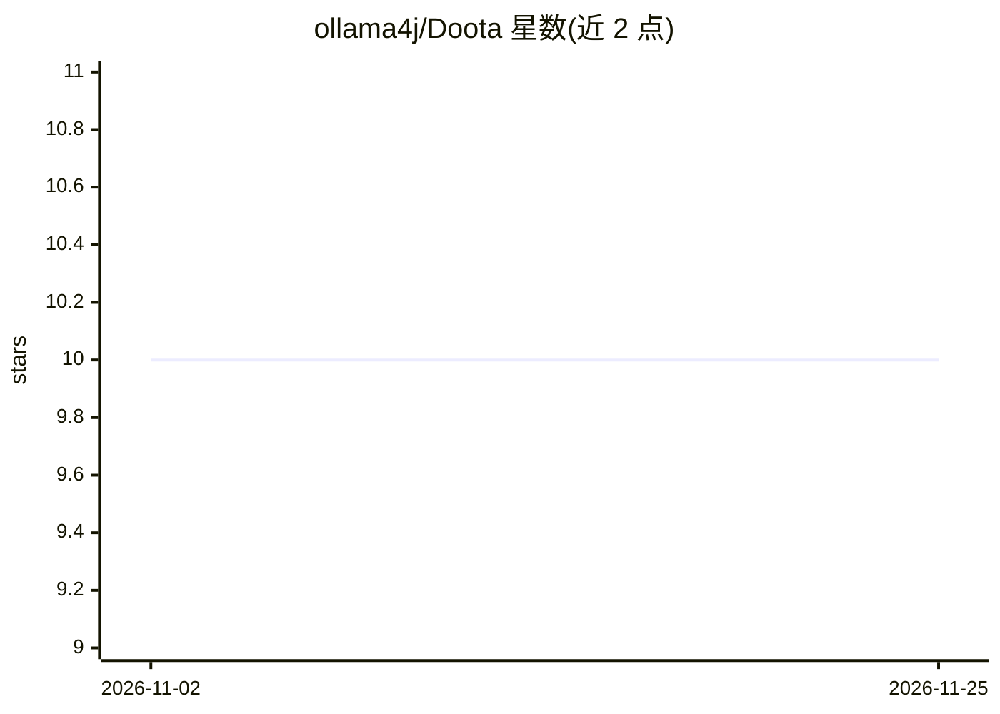

# ollama4j/Doota

⭐ 10 · Java · MIT · 推送 2026-05-24 · [GitHub](https://github.com/ollama4j/Doota) · [官网](https://ollama4j.github.io/Doota/) · 组织维护

**Ollama 的本地 Agent 客户端：自带工具与自主循环**

Doota 是面向 Ollama 的 agentic 系统，以 Java 打包的 `.jar` 桌面应用运行，需预先安装 Ollama。浏览器端执行自主 agent 循环（每次请求最多 10 次迭代），LLM 自主决定工具调用与排序；内置文件搜索/读取、系统诊断、计算器、天气等开箱工具，提供模型管理（搜索/过滤/卸载/删除）、连接心跳诊断与本地 JSON 聊天持久化。支持自定义 Ollama 主机 URL，可连本地或远程实例。

## 筛选速览

| 维度 | 判定 | 备注 |
|---|---|---|
| AI 角色 | `ai-ecosystem` | LLM/agent 周边工具 |
| 许可风险 | `permissive` | MIT |
| 部署形态 | `None` |  |
| 模型依赖 | local-ok | 支持本地模型 |
| 硬件要求 | — | 无带数字的原话,不猜 |
| 安装摩擦 | `low` | 无编译、无系统依赖或容器化 |
| 成熟度 | — | 结构信号不足 |

## 能力要点

- 浏览器端自主 agent 循环，单请求最多 10 次迭代
- 内置 9 个开箱工具：文件查找/读取、系统信息、计算器、天气等
- 模型管理：按家族/参数量/量化过滤，一键卸载释放内存
- 对话以 JSON 持久化到 ~/doota/chats，保留多轮上下文

## 适用场景

- 在私有本地环境运行带工具调用的 agent 对话
- 管理本地 Ollama 模型的加载、卸载与删除
- 让 agent 代为执行文件检索、系统诊断等本机任务

## 场景标签

`AI 助手` · 领域:对话与助手

## 证据(README 行号)

> L13:  Doota is agentic system for Ollama with built-in tools and an autonomous agent loop to power your private AI ecosy
> L42: * **Client-Driven Reasoning**: A fully autonomous agentic loop running directly in the browser (supporting up to 10

## 星数曲线

2026-11-02 10 → 2026-11-25 10（+0）

---
*卡片 v1 · prompt 1.4 · 生成 2026-11-19 · 置信度 high · 依据 README sha `4c1cb4b1aaf0` · [字段定义](../../DATASET.md)*
