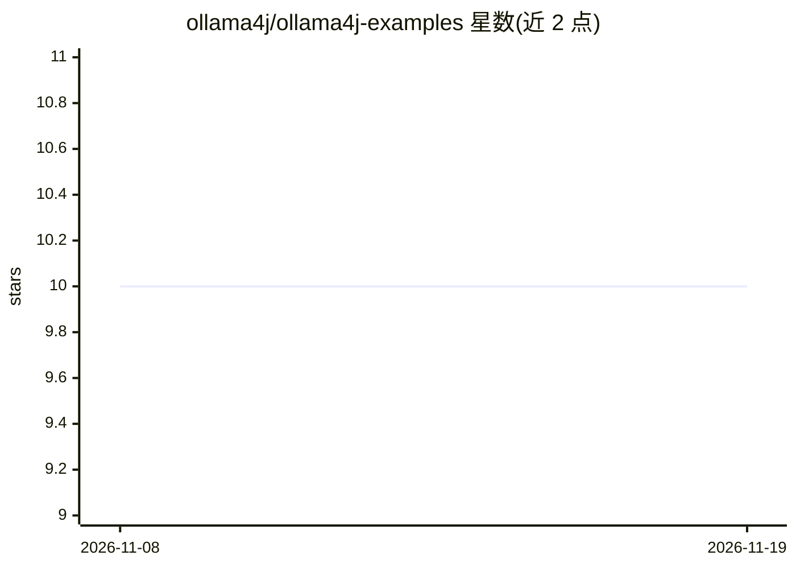

# ollama4j/ollama4j-examples

⭐ 10 · Java · MIT · 推送 2025-12-04 · [GitHub](https://github.com/ollama4j/ollama4j-examples) · [官网](https://ollama4j.github.io/ollama4j/) · 组织维护

**面向 Java 开发者的 Ollama4j 库示例集**

该仓库提供 Java 代码示例，演示如何使用 Ollama4j 库在 Java 应用中接入机器学习模型并与 Ollama 模型交互。内容以示例代码为主，可通过 make run 批量运行全部示例，运行前需在 resources/test-config.properties 中配置自定义 Ollama 连接参数。仓库定位为 Ollama4j 库的配套示例集合，面向需要在 Java 中调用 Ollama 模型的开发者。

## 筛选速览

| 维度 | 判定 | 备注 |
|---|---|---|
| AI 角色 | `ai-ecosystem` | LLM/agent 周边工具 |
| 许可风险 | `permissive` | MIT |
| 部署形态 | `None` |  |
| 模型依赖 | local-ok | 支持本地模型 |
| 硬件要求 | — | 无带数字的原话,不猜 |
| 安装摩擦 | `low` | 无编译、无系统依赖或容器化 |
| 成熟度 | — | 结构信号不足 |

## 能力要点

- 演示 Ollama4j 库在 Java 应用中的用法
- 提供 make run 一键批量运行全部示例
- 通过 resources/test-config.properties 自定义 Ollama 配置

## 适用场景

- 学习在 Java 中接入 Ollama 模型的代码写法
- 作为项目中调用 Ollama4j 的参考示例

## 场景标签

`教程课程` · 领域:学习与行业

## 证据(README 行号)

> L3: This repository provides Java code examples demonstrating how to use
> L7: ### Run all examples

## 星数曲线

2026-11-08 10 → 2026-11-19 10（+0）

---
*卡片 v1 · prompt 1.4 · 生成 2026-11-19 · 置信度 high · 依据 README sha `700a7fd809c0` · [字段定义](../../DATASET.md)*
