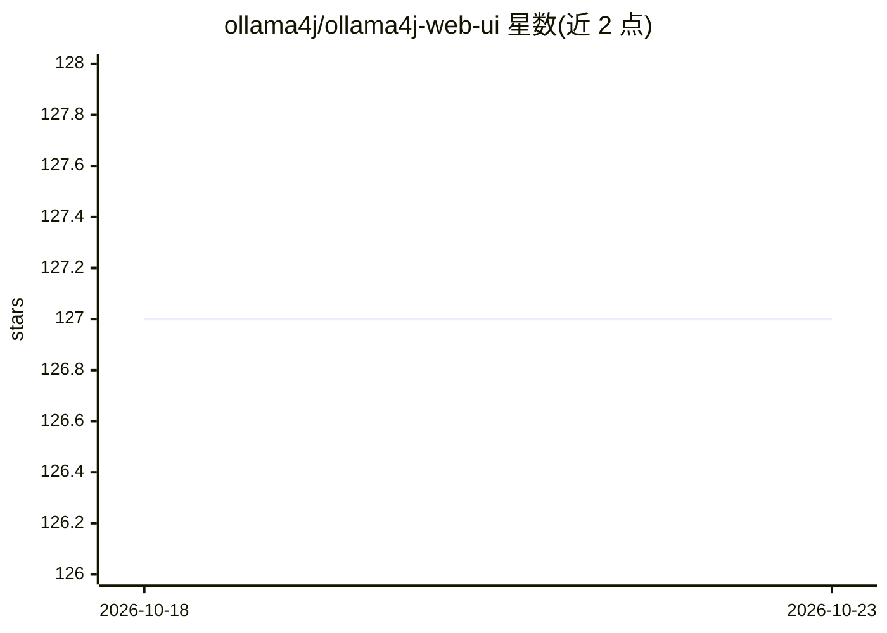

# ollama4j/ollama4j-web-ui

⭐ 127 · Java · MIT · 推送 2026-05-23 · [GitHub](https://github.com/ollama4j/ollama4j-web-ui) · [官网](https://github.com/ollama4j/Doota) · 组织维护

**面向 Java/Spring 用户的 Ollama Web 聊天界面**

用 Java 编写的 Ollama Web UI，基于 Spring Boot、Vaadin 框架与 Ollama4j 库构建，目标是让 Java/Spring 背景的 Ollama 用户获得完整可用的 Web 界面。功能包括 Chat、Image Chat、查看已下载模型与 Ollama 服务器模型列表。通过环境变量或 application.properties 配置 Ollama 地址，支持 Docker、Docker Compose 与独立 JAR 三种运行方式，需 Java 环境并依赖外部 Ollama 服务。仓库声明已停止积极维护并迁移到 Doota。

## 筛选速览

| 维度 | 判定 | 备注 |
|---|---|---|
| AI 角色 | `ai-ecosystem` | LLM/agent 周边工具 |
| 许可风险 | `permissive` | MIT |
| 部署形态 | `self-host` | docker 或自建部署 |
| 模型依赖 | local-ok | 支持本地模型 |
| 硬件要求 | — | 无带数字的原话,不猜 |
| 安装摩擦 | `low` | 无编译、无系统依赖或容器化 |
| 成熟度 | — | 结构信号不足 |

## 能力要点

- 基于 Spring Boot + Vaadin + Ollama4j 的 Web UI
- 支持 Chat、Image Chat 与模型列表查看
- 提供 Docker、Docker Compose 与独立 JAR 三种运行方式

## 适用场景

- Java/Spring 技术栈的开发者为 Ollama 服务配套 Web 聊天界面
- 通过 Docker Compose 一键启动 Ollama 与 Web UI
- 在浏览器中查看与切换 Ollama 服务器上的模型

## 场景标签

`聊天机器人` `图像生成` · 领域:对话与助手

## 证据(README 行号)

> L5: A web UI for Ollama written in Java
> L9: The goal of the project is to enable Ollama users coming from Java and Spring background to have a fully functional 

## 星数曲线

2026-10-18 127 → 2026-10-23 127（+0）

---
*卡片 v1 · prompt 1.4 · 生成 2026-10-23 · 置信度 high · 依据 README sha `e7f0cc530edf` · [字段定义](../../DATASET.md)*
