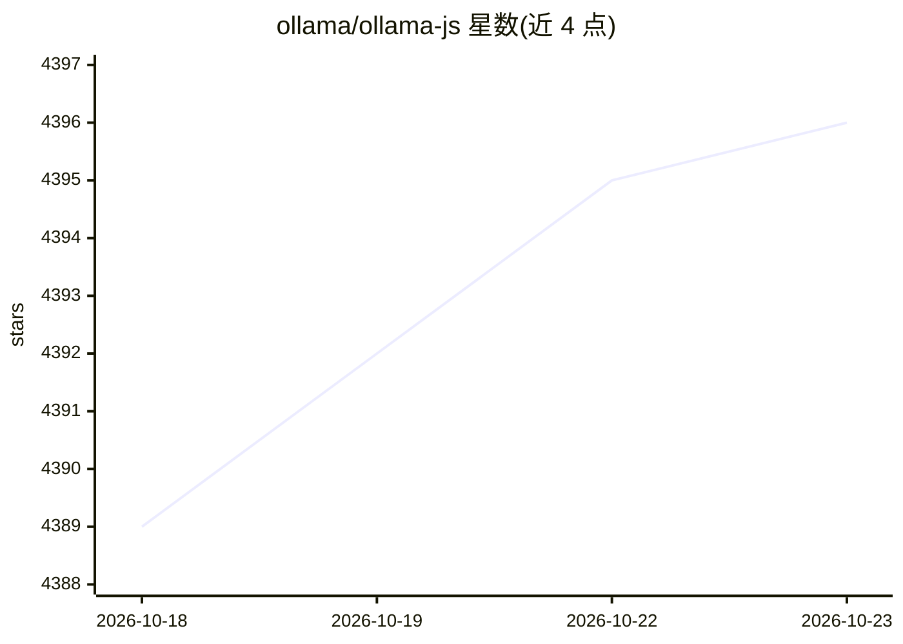

# ollama/ollama-js

⭐ 4,396 · TypeScript · MIT · 推送 2026-10-16 · [GitHub](https://github.com/ollama/ollama-js) · [官网](https://ollama.com) · 组织维护

**Ollama 官方 JavaScript 客户端库，供 JS 项目接入 Ollama**

围绕 Ollama REST API 设计的 TypeScript/JavaScript 库，覆盖 chat、generate、embed、pull/push、create、list、web search/fetch、abort 与 systemone 等接口；支持流式响应、工具调用、图像输入、思考模式与 logprobs 参数。提供浏览器模块（ollama/browser），可通过本地 Ollama 或 ollama.com 云 API 运行更大模型，支持自定义 host 与 fetch。限制：create 的 files 参数尚未支持，systemone 云端单请求最多 64 个问题。

## 筛选速览

| 维度 | 判定 | 备注 |
|---|---|---|
| AI 角色 | `ai-ecosystem` | LLM/agent 周边工具 |
| 许可风险 | `permissive` | MIT |
| 部署形态 | `library` | 以包/库形式分发 |
| 模型依赖 | local-ok | 支持本地模型 |
| 硬件要求 | — | 无带数字的原话,不猜 |
| 安装摩擦 | `low` | 无编译、无系统依赖或容器化 |
| 成熟度 | — | 结构信号不足 |

## 能力要点

- chat/generate/embed 等完整 Ollama REST API 封装，支持流式与工具调用
- Node 与浏览器双入口（ollama / ollama/browser）
- 支持 Ollama 云模型：本地自动卸载或直连 ollama.com API
- systemone 结构化问答接口（choice/noul/score 三类问题）

## 适用场景

- 在 Node.js 或浏览器应用中调用本地 Ollama 模型对话与生成
- 通过 JS 管理模型（pull/push/create/copy/delete/list）
- 用 embed 接口为检索场景生成文本嵌入
- 接入 Ollama 云运行超出本地资源的模型

## 场景标签

`推理引擎` · 领域:训练与推理

## 证据(README 行号)

> L3: The Ollama JavaScript library provides the easiest way to integrate your JavaScript project with Ollama.
> L89: The Ollama JavaScript library's API is designed around the Ollama REST API

## 星数曲线

2026-10-18 4,389 → 2026-10-23 4,396（+7）

---
*卡片 v1 · prompt 1.4 · 生成 2026-10-20 · 置信度 high · 依据 README sha `f9644ff9e8d6` · [字段定义](../../DATASET.md)*
