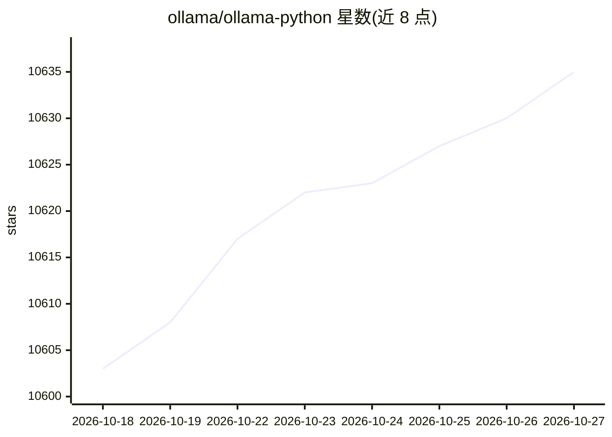

# ollama/ollama-python

⭐ 10,635 · Python · MIT · 推送 2026-10-16 · [GitHub](https://github.com/ollama/ollama-python) · [官网](https://ollama.com) · 组织维护

**Ollama 官方 Python 库：Python 3.8+ 项目接入 Ollama**

Ollama 官方 Python 客户端库，封装 Ollama REST API，提供 chat、generate、embed、list、pull、push、create 等同步/异步方法，支持流式输出与自定义 Client（透传 httpx 参数）。前提是本机安装并运行 Ollama，先 pull 模型。另可指向 ollama.com 云 API，使用 deepseek-v3.1、gpt-oss、kimi-k2 等云端模型，以及本地/云端运行的 System One 决策模型接口。通过 pip 安装。

## 筛选速览

| 维度 | 判定 | 备注 |
|---|---|---|
| AI 角色 | `ai-ecosystem` | LLM/agent 周边工具 |
| 许可风险 | `permissive` | MIT |
| 部署形态 | `library` | 以包/库形式分发 |
| 模型依赖 | local-ok | 支持本地模型 |
| 硬件要求 | — | 无带数字的原话,不猜 |
| 安装摩擦 | `low` | 无编译、无系统依赖或容器化 |
| 成熟度 | — | 结构信号不足 |

## 能力要点

- 封装 Ollama REST API 的同步/异步客户端（chat/generate/embed 等全量方法）
- 流式输出（stream=True）与自定义 host/headers 的 Client
- 可接入 ollama.com 云端大模型（deepseek-v3.1、gpt-oss、kimi-k2 等）
- System One 决策模型接口：choice/noul/score 三类问题，支持本地与云端

## 适用场景

- 在 Python 项目中调用本地 Ollama 模型做对话或文本生成
- 通过云 API 调用更大参数量的云端模型
- 在异步代码中流式消费模型输出
- 生成文本嵌入用于检索等下游任务

## 场景标签

 · 领域:LLM 基础设施/客户端库

## 证据(README 行号)

> L3: The Ollama Python library provides the easiest way to integrate Python 3.8+ projects with Ollama.
> L127: The Ollama Python library's API is designed around the Ollama REST API

## 星数曲线

2026-10-18 10,603 → 2026-10-27 10,635（+32）

---
*卡片 v1 · prompt 1.4 · 生成 2026-10-20 · 置信度 high · 依据 README sha `51d4e00bda99` · [字段定义](../../DATASET.md)*
