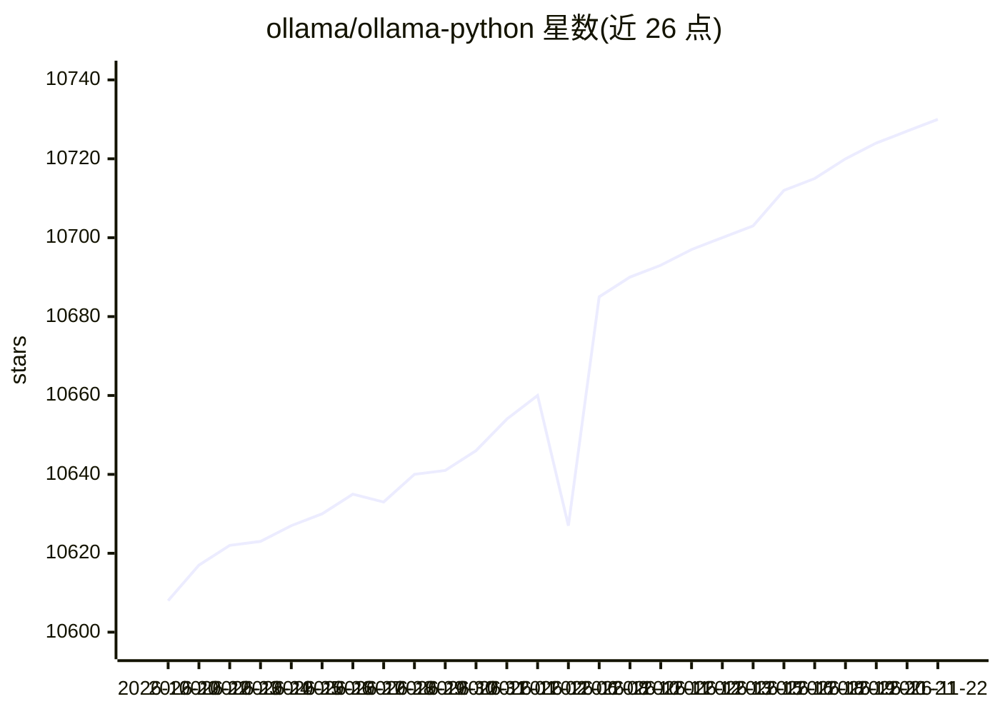

# ollama/ollama-python

⭐ 10,730 · Python · MIT · 推送 2026-11-17 · [GitHub](https://github.com/ollama/ollama-python) · [官网](https://ollama.com) · 组织维护

**面向 Python 3.8+ 项目接入 Ollama 的官方客户端库**

该库为 Python 3.8+ 项目提供与 Ollama 集成的接口，API 围绕 Ollama REST API 设计，覆盖 chat、generate、embed（含批量）、pull/push、create、list、show、delete、ps 等操作，支持同步、异步（AsyncClient）与流式响应，自定义 Client 可传入 host 与额外 header（底层使用 httpx）。使用前提是本机安装并运行 Ollama 且已拉取模型。此外支持通过本地 Ollama 或 ollama.com 云 API（API key 鉴权）运行云模型，并提供 ollama.systemone 决策问答接口，云端访问需付费计划。

## 筛选速览

| 维度 | 判定 | 备注 |
|---|---|---|
| AI 角色 | `ai-ecosystem` | LLM/agent 周边工具 |
| 许可风险 | `permissive` | MIT |
| 部署形态 | `library` | 以包/库形式分发 |
| 模型依赖 | local-ok | 支持本地模型 |
| 硬件要求 | — | 无带数字的原话,不猜 |
| 安装摩擦 | `low` | 无编译、无系统依赖或容器化 |
| 成熟度 | — | 结构信号不足 |

## 能力要点

- 覆盖 chat/generate/embed/pull/push/create 等完整 Ollama REST API 封装
- 支持流式响应与异步 AsyncClient
- 支持本地 Ollama 与 ollama.com 云 API 两种方式运行云模型
- systemone 决策问答接口支持 choice/noul/score 题型及图像输入

## 适用场景

- 在 Python 应用中调用本地 Ollama 模型生成对话与文本
- 为文档批量生成向量嵌入
- 通过云 API 在本地工作流中运行更大参数的模型

## 场景标签

 · 领域:LLM 基础设施/客户端库

## 证据(README 行号)

> L3: The Ollama Python library provides the easiest way to integrate Python 3.8+ projects with Ollama.
> L127: The Ollama Python library's API is designed around the Ollama REST API

## 星数曲线

2026-10-20 10,608 → 2026-11-22 10,730（+122）

---
*卡片 v1 · prompt 1.4 · 生成 2026-11-22 · 置信度 high · 依据 README sha `bf4bfbf8f040` · [字段定义](../../DATASET.md)*
