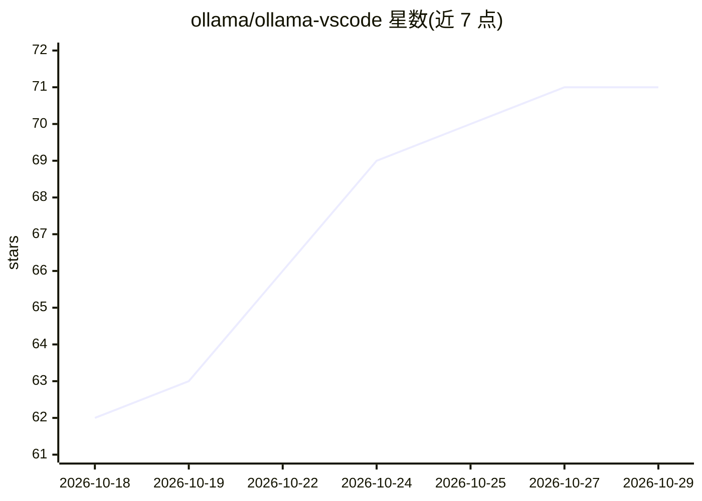

# ollama/ollama-vscode

⭐ 71 · JavaScript · MIT · 推送 2026-10-22 · [GitHub](https://github.com/ollama/ollama-vscode) · 组织维护

**把运行中的 Ollama 模型接入 VS Code Chat 的官方扩展**

Ollama 官方维护的 VS Code 扩展：将本地 Ollama 服务器的模型添加到 VS Code Chat 模型选择器，默认从 http://127.0.0.1:11434 发现模型；支持本地与云端模型（云端需 ollama signin，推荐 Ollama 0.17.6+）。提供 thinking effort 按模型配置（ollama.thinkingLevels 设置，读取服务器 /api/show 广播值）、Refresh Models 与 Diagnose Models 两个命令、推理超时可调。要求 VS Code 1.127+ 与已运行的 Ollama。

## 筛选速览

| 维度 | 判定 | 备注 |
|---|---|---|
| AI 角色 | `ai-ecosystem` | LLM/agent 周边工具 |
| 许可风险 | `permissive` | MIT |
| 部署形态 | `None` |  |
| 模型依赖 | local-ok | 支持本地模型 |
| 硬件要求 | — | 无带数字的原话,不猜 |
| 安装摩擦 | `low` | 无编译、无系统依赖或容器化 |
| 成熟度 | — | 结构信号不足 |

## 能力要点

- 将 Ollama 服务器模型注册到 VS Code Chat 模型选择器
- 按模型配置 thinking effort（ollama.thinkingLevels）
- Refresh Models / Diagnose Models 命令用于刷新与排障
- 支持本地与云端模型，推理超时可配置

## 适用场景

- 在 VS Code Chat 中直接选用本地 Ollama 模型
- 为兼容模型调节思考力度（thinking effort）
- 模型未出现在选择器时用 Diagnose Models 排查

## 场景标签

`AI 助手` · 领域:对话与助手

## 证据(README 行号)

> L3: Use Ollama models in VS Code Chat.
> L5: The Ollama extension adds models from your running Ollama server to the VS Code
> L6: model picker.

## 星数曲线

2026-10-18 62 → 2026-10-29 71（+9）

---
*卡片 v1 · prompt 1.4 · 生成 2026-10-24 · 置信度 high · 依据 README sha `c33db9305f89` · [字段定义](../../DATASET.md)*
